# DeuceMate 🎾

**A reliable, privacy-focused tennis scoring app for Apple Watch — with iPhone companion for live viewing, announcements, and match history**

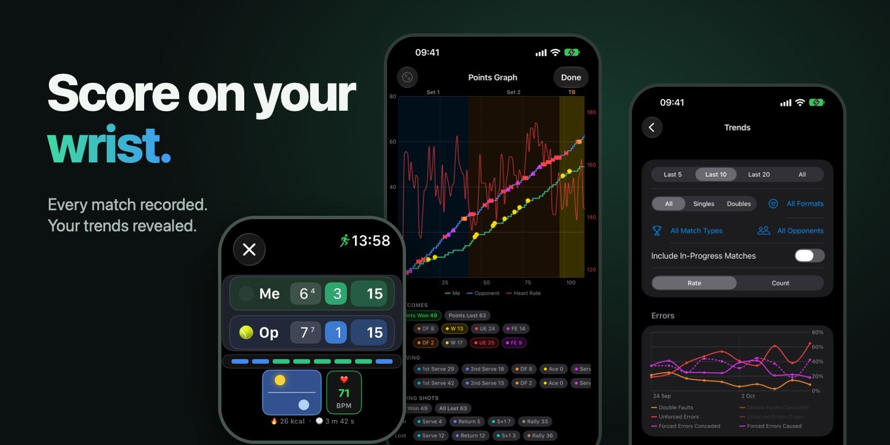

### [▶ Try it in your browser](https://emrahman.github.io/DeuceMate/try.html) · [📲 Download on the App Store](https://apps.apple.com/app/id6757105622)

Free, no ads, no tracking.

DeuceMate is a lightweight, native Apple Watch app for scoring tennis matches in real time, bundled with an **iPhone companion app** for live score viewing, umpire-style announcements, and a complete match archive with detailed statistics. Built from the ground up with SwiftUI, it delivers a fast, reliable scoring experience without the bloat, crashes, or privacy concerns of existing alternatives.

## Screenshots

### On your wrist

| 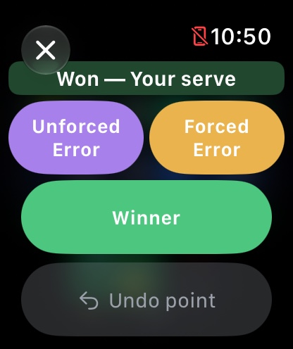 | 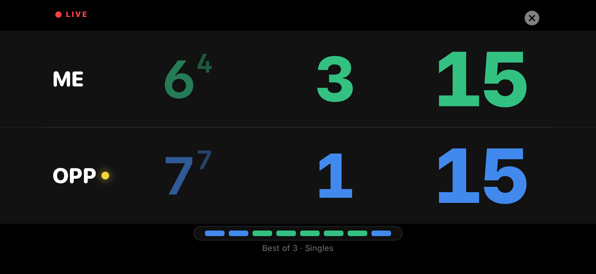 |
|:--:|:--:|
| **Tag how each point ended. Every stat below starts here.** | **Same score, live on your iPhone.** |

### Understand the match

| 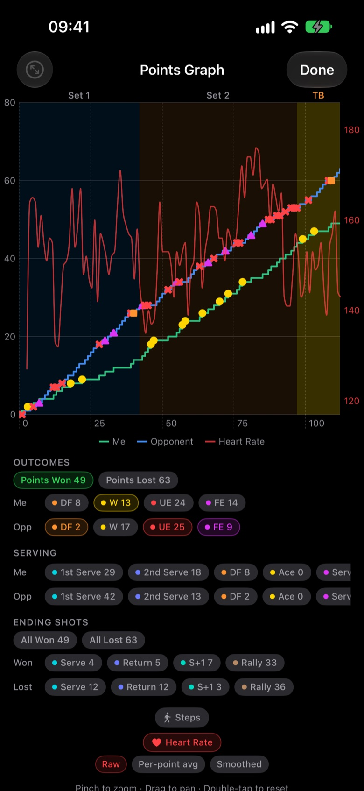 | 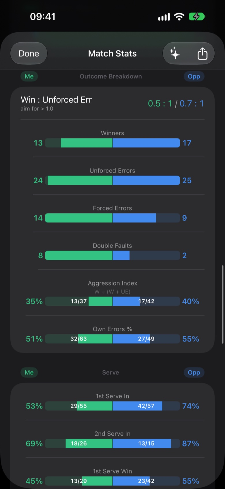 | 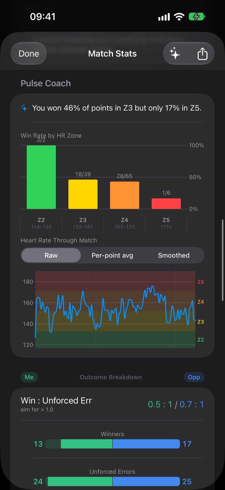 |
|:--:|:--:|:--:|
| **See every point, and how each one ended.** | **20+ stats, side by side.** | **Find the heart-rate zone you win in.** |

### See the pattern

| 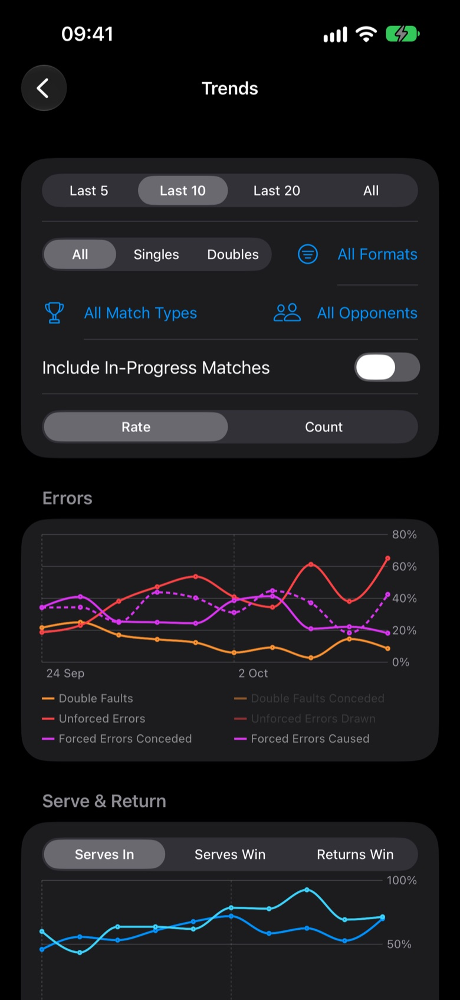 | 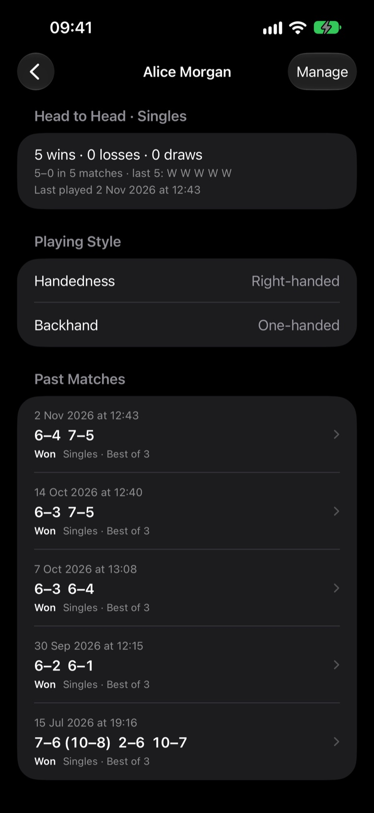 | 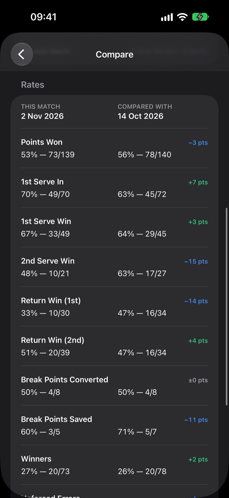 |
|:--:|:--:|:--:|
| **Know what's improving and what's slipping.** | **Your record against every opponent.** | **See what changed since you last played them.** |

### Get coached, then share it

| 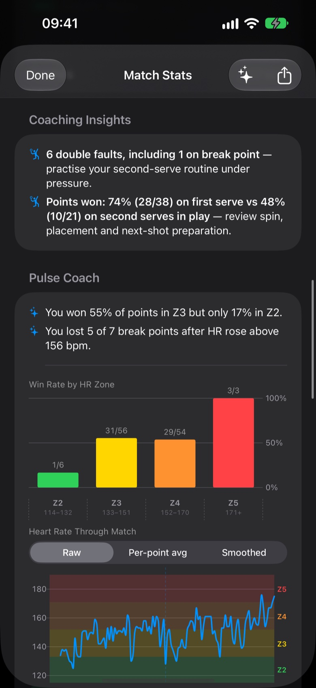 | 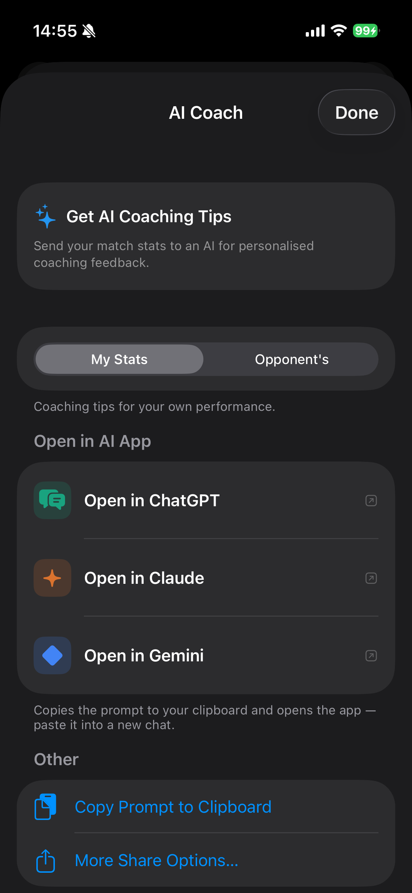 | 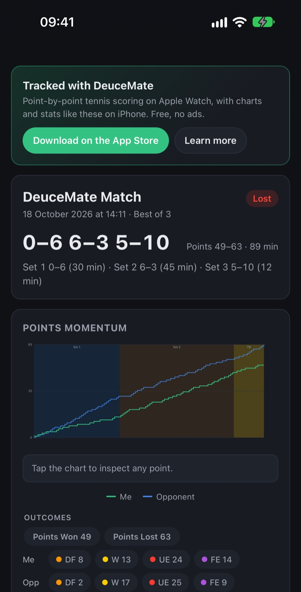 |
|:--:|:--:|:--:|
| **Coaching insights from your own points.** | **Hand any match to ChatGPT, Claude or Gemini.** | **Share a match as one web page. No app needed.** |

### Make it yours

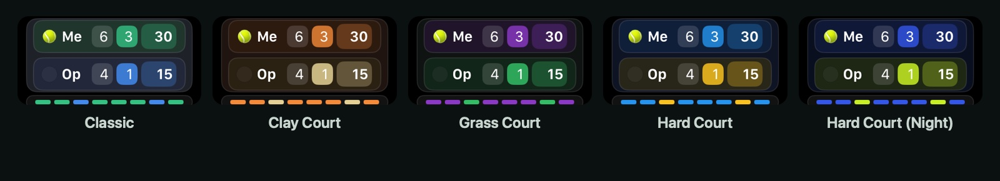

**Five court-inspired themes.**

## Why DeuceMate Exists

After trying multiple tennis scoring apps that crashed mid-match, collected unnecessary data, or required subscriptions with intrusive ads, I built DeuceMate to be:
- **Reliable** - Core scoring works offline with optimized battery usage
- **Private** - No developer data collection, analytics, or tracking
- **Simple** - Clean interface focused on the essentials
- **Free** - No subscriptions, ads, or in-app purchases

This project also showcases my ability to ship production-quality native iOS/watchOS apps from concept to App Store — built end-to-end with an AI-agent development workflow (see [Development](#development)).

## Features

**Gesture-first scoring on Apple Watch**

| Gesture | Action |
|---------|--------|
| Swipe up | Award point to you |
| Swipe down | Award point to opponent |
| Double tap | Toggle second-serve context |
| Swipe left | Undo last point (full game-state rollback) |
| Swipe right | Open live stats view |

- **Complete tennis scoring** — games, sets, tiebreaks, deuce/advantage, automatic server rotation, break-point detection, and side-change prompts with a compass court-end badge. Seven match formats; singles and doubles with full service-order management.
- **Straight into the match** — the watch remembers your last format and singles/doubles choice, so Start Match goes directly to who serves first, and a pre-match strip states up front whether point tracking, Health, and Pulse Coach will record this match.
- **A changeover reminder that stays put** — after a set, the "change ends" notice persists on the scoreboard until the first point of the next set, so you can check it whenever you look down instead of undoing a point to see it again.
- **Bulletproof state** — full undo stack across game and set boundaries; in-progress matches survive backgrounding, notifications, and overnight pauses.
- **iPhone companion** — stadium-style live scoreboard, umpire-style spoken announcements, optional swipe-to-score iPhone Input, manual match entry, and an unlimited on-device archive.
- **Point outcome tracking** — tag every point with a cause and ending shot to unlock serve, return, break-point, pressure, rally-depth, and score-state analytics, filterable per set or whole match.
- **Coaching insights** — Coaching Insights (up to three ranked observations per match) and PulseCoach (heart-rate-correlated insights), plus an interactive points-momentum graph with HR and steps overlays.
- **Performance trends** — charts across your matches show what is improving and what is slipping, filterable by window, match type, format, competition type, and opponent.
- **Match details and opponents** — add players, competition type, and a private note to any match, see your head-to-head record against each opponent, and compare a match with your previous one against them.
- **AI coaching exports** — one tap builds a structured coaching prompt (including the raw point-by-point table) for ChatGPT, Claude, Gemini, and others, with a dual perspective mode so your opponent gets coached too.
- **Shareable interactive web report** — export any match as a single self-contained HTML page (momentum chart with toggleable outcome/shot scatter, the full Me-vs-opponent stats with Stats/Points tabs and per-set filters, and a built-in AI-coach launcher) that opens in any browser, fully offline — no app, account, or server.
- **Health & fitness** — optional HealthKit workout with live heart rate, calories, steps, distance, and per-set timers.
- **Five court-inspired themes**, momentum strip, and point-confirm highlight — all synced between watch and iPhone.

📖 **[User Guide](docs/USER_GUIDE.md)** — the full reference: every gesture, format, statistic, coaching rule, and export mode, plus battery numbers, padel compatibility, and a refresher on tricky tennis rules.

## Privacy

The developer does not collect or receive data from DeuceMate and operates no backend, analytics, advertising, or tracking. Match data is stored on your Apple devices and, when available, in an automatic archive in your personal iCloud Drive that excludes HealthKit measurements. Apart from that archive, data leaves DeuceMate only when you explicitly export or share it, including with an AI service you select. See [PRIVACY_POLICY.md](PRIVACY_POLICY.md) (also published at [emrahman.github.io/DeuceMate/privacy.html](https://emrahman.github.io/DeuceMate/privacy.html)).

## Requirements & Installation

- **App Store:** [Download DeuceMate](https://apps.apple.com/app/id6757105622) — free, no in-app purchases
- Apple Watch Series 4 or later (including SE and Ultra), watchOS 9.0+
- iPhone running iOS 17.0+ (the watch app is bundled with the iOS app, so installing on iPhone installs both)

## Support & Feedback

- 🌐 Support site: [emrahman.github.io/DeuceMate/support.html](https://emrahman.github.io/DeuceMate/support.html)
- 📧 Email: [mail@ehsanrahman.com](mailto:mail@ehsanrahman.com?subject=DeuceMate%20Feedback)
- 🐛 Report issues: [GitHub Issues](https://github.com/EMRahman/DeuceMate/issues)

## Development

Native SwiftUI on both platforms with **zero third-party dependencies** — Apple frameworks only (WatchConnectivity, HealthKit, AVFoundation, CoreMotion/CoreLocation, Swift Charts). All portable logic — models, the pure scoring engine, stats derivation, the sync wire format, and merge policy — lives in the shared `DeuceMateCore` Swift package with comprehensive unit tests. The watch is the source of truth for live matches; the iPhone is the durable read-only archive, synced over WatchConnectivity with queue-and-deliver semantics.

**AI-agent workflow:** the repo is deliberately structured for agentic development — [`CLAUDE.md`](CLAUDE.md) is the operating guide coding agents follow (architecture map, multi-site change recipes, known traps), [`docs/architecture/`](docs/architecture/) holds the component, sync, and match-lifecycle diagrams agents keep current, and [`docs/features/TECHNICAL_DEBT.md`](docs/features/TECHNICAL_DEBT.md) is the prioritised backlog they work from. Changes land as agent-authored PRs held to the rules in [`CONTRIBUTING.md`](CONTRIBUTING.md).

Architecture documentation: [`docs/architecture/`](docs/architecture/) — component topology, sync and data-flow, match lifecycle, and a complete file inventory.

## Contributing

Contributions are welcome! Please feel free to:
- Open issues for bugs or feature requests
- Submit pull requests with improvements
- Share feedback from using the app

See [CONTRIBUTING.md](CONTRIBUTING.md) for conventions.

## License

This project is licensed under the MIT License - see the [LICENSE](LICENSE) file for details.

## Author

**Ehsan Rahman**
🌐 [ehsanrahman.com](https://ehsanrahman.com)
💼 [GitHub](https://github.com/EMRahman)

---

**Built with ❤️ for tennis players worldwide 🎾**

*This project showcases production-quality native iOS/watchOS development. DeuceMate is [live on the App Store](https://apps.apple.com/app/id6757105622).*
