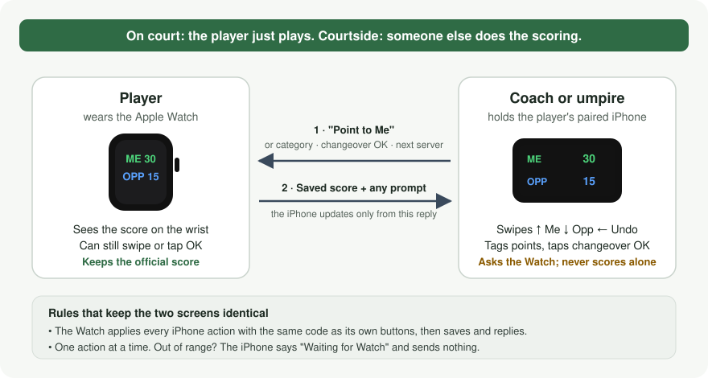
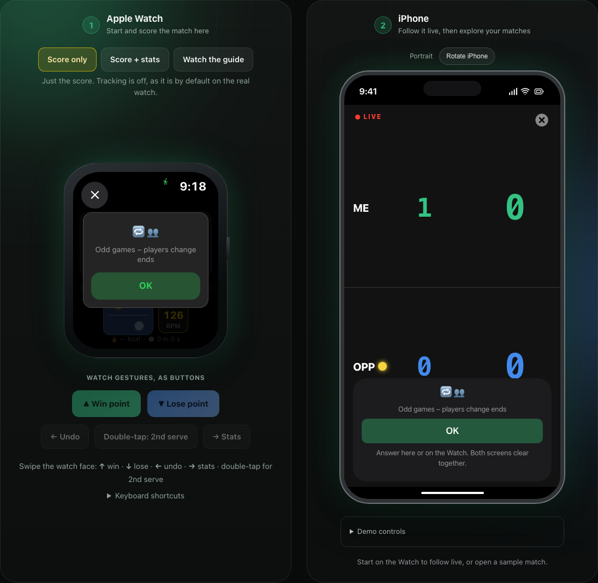
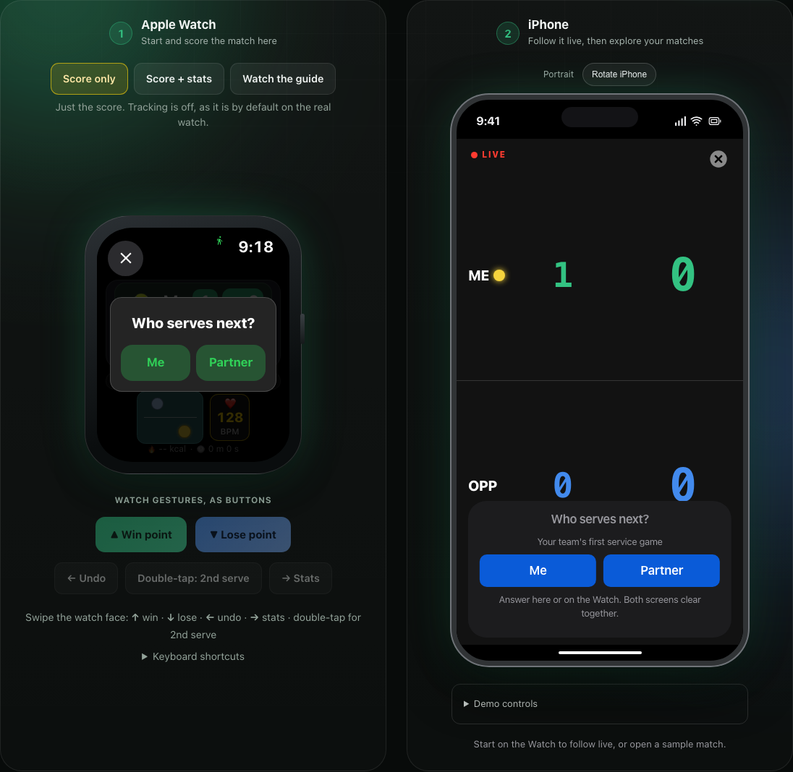
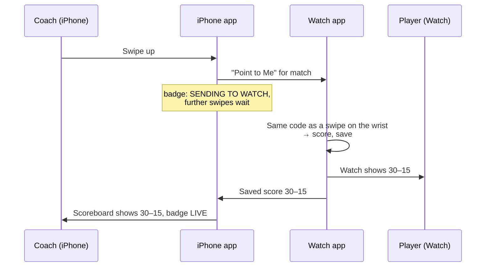
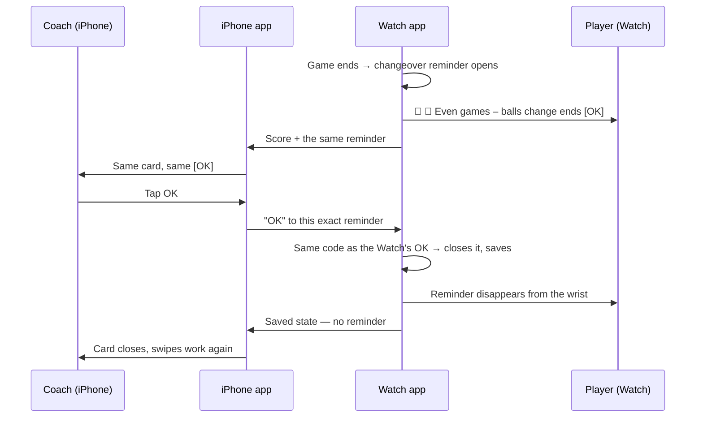

# Courtside scoring: the player wears the Watch, someone else keeps score

DeuceMate lets a **coach, parent, umpire or friend** do the scoring on the
player's iPhone while the **player just plays** with the Apple Watch on their
wrist. The player can glance at the score at any time; the person courtside
swipes for every point, tags how points ended, and answers the Watch's
changeover and "who serves next?" screens.

**The one rule behind everything:** the Watch keeps the score. The iPhone is a
remote control for it. Every tap on the iPhone is *sent to the Watch*, the Watch
applies it exactly as if it had been done on the wrist, saves it, and sends the
result back. The iPhone only changes what it shows when that answer arrives, so
the two screens can never tell different stories.

---

## Before the match (2 minutes)

| | Who | What to do |
|---|---|---|
| 1 | Player | Wear the Apple Watch. Use **the iPhone it is paired with** — DeuceMate can't connect another person's phone. |
| 2 | Either | Turn on **iPhone Input**: on the iPhone in **Settings → Shared Configurations**, or on the Watch in its Settings. It syncs both ways. With it off, the iPhone is a view-only scoreboard. |
| 3 | Player | On the Watch, choose the format and **Start Match**, then pick who serves first. Starting a match, and choosing the first server, only happen on the Watch. |
| 4 | Scorer | On the iPhone, open DeuceMate → **Matches** → **Live Match** → **Live Scoreboard**. The phone turns sideways into a large scoreboard and stays awake. |
| 5 | Scorer | Check the badge in the top-left corner says a red **LIVE**. You're ready. |

Keep DeuceMate open on the Watch during play (a running match keeps it active).
If the Watch app isn't active, the iPhone can't reach it — see
[the badge](#what-the-badge-means) below.

---

## During the match

### Scoring a point

On the iPhone scoreboard, swipe anywhere:

| Swipe | Does |
|---|---|
| ↑ up | Point to **Me** (the player wearing the Watch) |
| ↓ down | Point to the **Opponent** |
| ← left | **Undo** the last point |

While your finger is down, the row that will get the point lights up (green for
Me, red for the opponent), so a wrong-way swipe is visible before you lift. The
score changes a moment later, when the Watch confirms it. The badge briefly
reads **SENDING TO WATCH** while it waits.

> The iPhone can't mark a **second serve**. The player double-taps the Watch
> for that, and the iPhone scoreboard shows a small "2" next to the server.

### Tagging how the point ended (optional)

If **outcome tracking** is on, a panel slides up after each point —
Winner / Forced Error / Unforced Error (and Double Fault after a second-serve
fault), then the shot it ended on. It is the same question the Watch asks, and
either device can answer it. Use **Undo point** on the panel to take the point
back instead.

### Changeovers — "balls change ends", "players change ends"

When a game or set ends at a changeover, the Watch shows a reminder such as
**🔁 🎾 Even games – balls change ends**. The same card now appears on the
iPhone, with the same **OK** button:

- Tap **OK on the iPhone** and the reminder **closes on the Watch too** — the
  player doesn't need to touch their wrist.
- Or the player taps OK on the Watch, and the iPhone card closes.
- Scoring is paused until one of you taps OK. That's deliberate: it makes sure
  someone saw the reminder. A swipe while it's showing gives a warning buzz and
  does nothing.

### Doubles — "Who serves next?"

In doubles, if the opponents served first, the Watch can't know which of you
serves your team's first game until it comes round. After that first game it asks
**Who serves next? — Me / Partner**. The question now appears on the iPhone too:

Tap **Me** or **Partner** on either device; both screens close and the rest of
the match's serving order is fixed. If the same game also triggered a changeover,
"Who serves next?" comes first, then the changeover — in that order on both
devices.

### Just watching?

With **iPhone Input off**, the iPhone still shows the score, the changeover
reminders and "Who serves next?", labelled *Waiting for the Watch. Turn on iPhone
Input to answer here.* Nothing you do on the phone can change the match.

### Ending the match

The match ends by itself on match point, on the Watch. To stop early, the player
closes the match on the Watch — it is kept as unfinished and can be resumed
later — and either of you can use **End at Current Score** to finish it at the
score it reached.

---

## What the badge means

| Badge (top-left) | Meaning | What to do |
|---|---|---|
| 🔴 **LIVE** | The iPhone has the Watch's current score and can send. | Score away. |
| 🟠 **SENDING TO WATCH** | Your last tap is on its way; the next one waits. | Nothing — it clears in a moment. |
| 🟠 **SYNCING WITH WATCH** | The iPhone is fetching the current score (on opening, or after reconnecting). | Wait a second. |
| 🟠 **WAITING FOR WATCH** | The Watch can't be reached — out of range, Bluetooth off, or DeuceMate not active on the Watch. The last score is still shown, and **nothing you swipe is sent or saved for later.** | Ask the player to raise their wrist / open DeuceMate on the Watch, then tap **Refresh** if it appears. |

If you ever see **"Not confirmed by the Watch. Check the score before
retrying."**, the Watch may or may not have counted your last action (the reply
got lost). Look at the score before swiping again — the iPhone never resends on
its own, so a point can't be counted twice by accident.

---

## How it works

### A point scored from the iPhone

### A changeover answered from the iPhone

If the player taps OK on the Watch first, the iPhone's later "OK" arrives for a
reminder that is already closed; the Watch politely ignores it and sends back the
current state. Every answer names the exact screen it's answering, so a late tap
can never close a *different* reminder — not even a later one with the same
words, such as the next "players change ends".

### Why the Watch stays in charge

- **One scorekeeper, no arguments.** Two devices keeping separate scores would
  eventually disagree. With one keeper, the wrist and the phone always match.
- **It keeps going without the phone.** If the iPhone drops out, the player can
  carry on scoring on the Watch; the iPhone catches up when it reconnects.
- **Nothing is replayed.** The iPhone never queues up swipes for later, so
  walking back into range can't suddenly add points.

---

## Good to know

- **Agree who scores.** If the player and the coach both swipe for the same
  rally, both points count — the Watch can't tell it was the same rally. Use
  Undo to fix it.
- **Older app versions.** If one device hasn't been updated, the iPhone shows
  *"Continue on the Watch before scoring."* instead of the changeover card, and
  the player taps OK on the Watch as before. Update both apps to answer from the
  phone.
- **Announcements.** With announcements on, the iPhone can also call the score
  aloud — useful when the scorer wants to keep their eyes on the court.
- **Try it without a Watch.** The [interactive demo](https://emrahman.github.io/DeuceMate/try.html)
  pairs a simulated Watch with a simulated iPhone; turn on iPhone Input in its
  iPhone Settings and play a game to see the changeover card on both.

*For the technical design (message shapes, safety checks, tests) see
[`features/LIVE_WATCH_SYNC_PROPOSAL.md`](features/LIVE_WATCH_SYNC_PROPOSAL.md)
and [`architecture/sync-and-data-flow.md`](architecture/sync-and-data-flow.md).*
