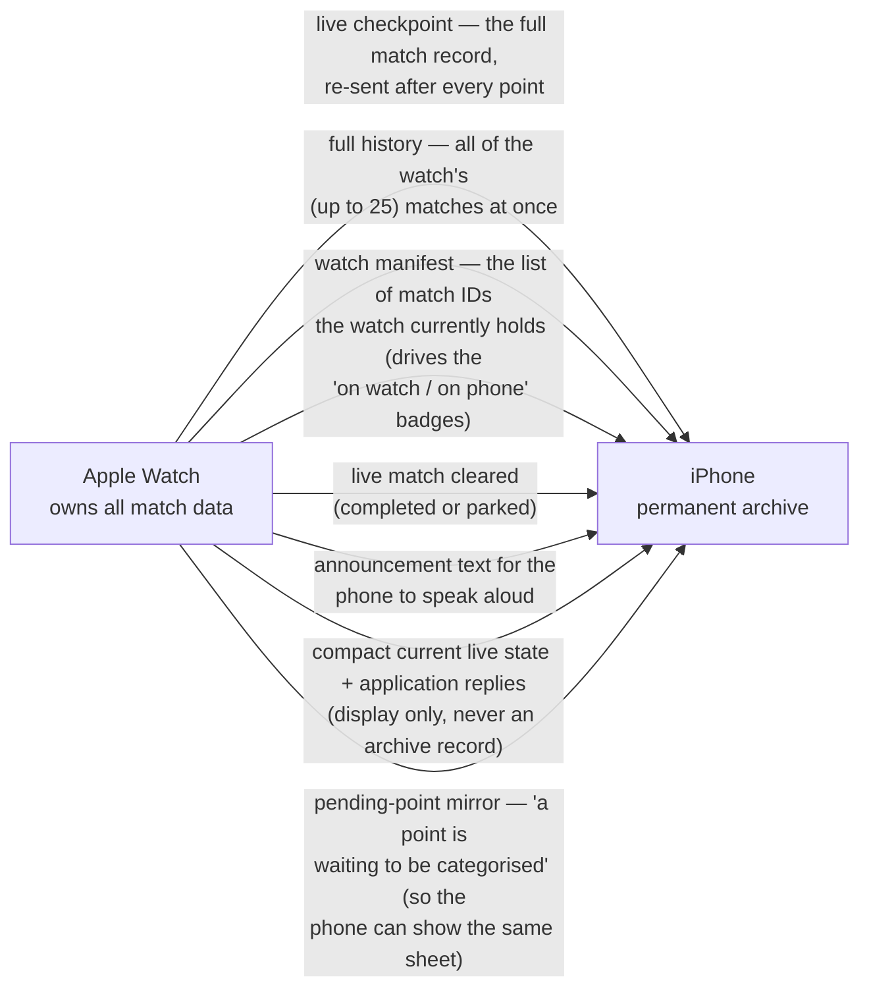
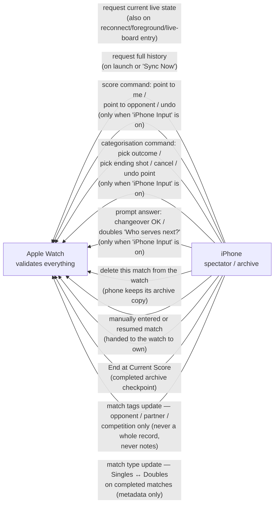
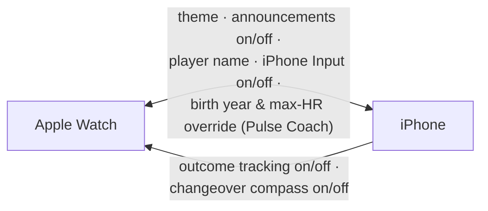
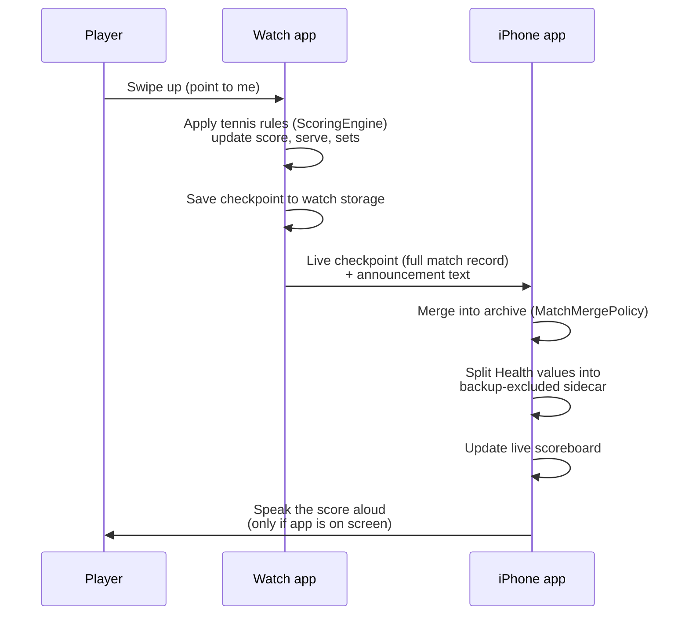
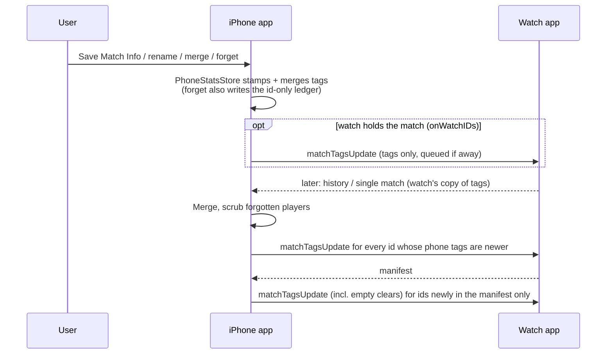

# Sync & Data Flow — what travels between the watch and the phone

Everything between the two apps crosses **WatchConnectivity**, Apple's
watch-to-phone bridge. Each side has one "sync service" file
(`WatchMatchSyncService` on the watch, `PhoneMatchSyncService` on the phone);
the message vocabulary, encoding and merge rules live in the shared package so
both sides are guaranteed to speak the same dialect
(`MatchSyncMessage`, `MatchSyncPayloadBuilder`, `SyncIncomingPayload`,
`MatchSyncTransport`, `MatchMergePolicy`).

The golden rule from the [topology map](README.md): **the watch owns live scoring
and match data normally flows watch → phone.** Phone → watch traffic is requests
and validated commands, plus two explicit archive actions: manual-entry records
and **End at Current Score** completions.

Display recency is derived by Core `MatchChronology`: finish date for completed
records, latest recorded point (or original start) for unfinished records. Both
stores, the Watch mirror, backup previews, imports and restores share it. Sorting
never changes body-resolution authority, tags/revision clocks or tombstones, and
existing archives are ordered on read without bulk rewriting. The stable final
scoring instant lives only in Watch `AppState` until finalization; reversible live
checkpoints continue to carry nil `endTime` and `iWon` so undo can replace them.
No match-record or wire shape changes are needed for completion chronology.

## 1. Match data — one way, watch → phone



Delivery is pragmatic: live checkpoints go instantly when the phone is reachable
(and are silently skipped when it isn't — the next checkpoint supersedes them);
important records are queued so they survive locked screens; large history pushes
go as file transfers. That strategy lives in `MatchSyncTransport`. Commands from
the phone's live scoreboard are the exception to queuing: they are never queued
or retried, the scoreboard blocks them while the Watch is unreachable, and a
failed send shows a short message. A successfully
read full-history request ends with the Watch manifest; an unreadable Watch
archive sends neither history nor a misleading empty manifest. The phone treats
a received manifest as the successful acknowledgement even when it is empty,
because the transport intentionally sends no history file for an empty Watch
archive. The Sync Now result shows both device counts; if the iPhone has archived
matches and a fresh Watch has none, it directs the user to open a match and choose
**Sync to Watch** to restore selected records. Watch pairing/installation changes
are refreshed through `sessionWatchStateDidChange`, rather than remaining frozen
at activation.

A failed iPhone archive read preserves canonical files in place and pauses
archive writes, exports, Watch archive merges, and iCloud backup. The Matches
screen shows recovery actions (`ArchiveProblemNotice` / `ArchiveRecoveryModel`)
and keeps the live scoreboard accessible. A successful retry or iCloud restore
requests the Watch's full history again. Archive deletion, manual entry, and End
at Current Score issue their Watch-side changes (and private-note deletion) only
after the local commit succeeds. After a transient Watch delivery write failure
commits on retry, the phone also reconciles committed tags and match-type
revisions for the retried IDs. A failed local write puts the deletion-intent
files (and any overwritten Health sidecar, with backup exclusion reapplied)
back as they were, so a delete the user was told didn't happen can't happen at
the next launch or drop Health measurements.

While the archive is paused, the iPhone refuses Watch archive deliveries, so the
Watch holds the only copy of new matches until a retry or restore asks for its
full history. The Watch still trims to its 25-match cap meanwhile
(TECHNICAL_DEBT #29).

**iCloud push floor & recovery.** Every outbound backup push goes through Core's
`BackupPushGuard`: a match may leave the backup only with a tombstone or a
confirmed Replace import. Otherwise the history file is withheld ("iCloud backup
paused") while tombstones and forgotten players are still pushed. The baseline
is the iCloud-account-scoped, device-backup-excluded `backupManifest.json`, or
the backup's own match ids (`BackupRecordID`) when that is missing or belongs
to another account. When the remote backup files themselves are unreadable or
declare a newer schema version, pushes pause visibly (`RemoteBackupProblemNotice`)
instead of claiming `"Backed up to iCloud"`. First-launch restore reads the
backup leniently (`LenientRecordList`), excludes tombstoned matches from its
preview, names any newer-format matches that stay in iCloud, and defers without
marking initialized if *every* match requires a newer build. Bring Them Back
(preserving local Health sidecar values and reconciling remotely tombstoned ids)
and Remove from Backup (acting only on the confirmed id set after copying raw
iCloud history to `MatchArchive/Recovered/`) resolve a withheld push. Before a
confirmed Replace pushes over iCloud, DeuceMate copies the current iCloud
`matchHistory.json` raw bytes into `MatchArchive/Recovered/` and holds the push
until that copy exists (`pendingReplaceManifest`).

**Live recovery (16 November 2026):** activation, reconnect, phone foreground,
opening the live board and Sync Now request the existing Watch model's current
state through `liveRequest`/`liveReply`. A compact display-only snapshot carries
score, pending category/phase, permission and blockers, or explicit idle/error.
It never enters archive merging. An explicit refresh or Watch history/reconnect
push also sends the full live record reliably (file transfer when large), without
putting it in Watch history. Normal Watch mutations publish compact state via
both `sendMessage` (when reachable) and `updateApplicationContext` (so the latest
score still delivers over Bluetooth even when the Watch screen is dimmed and
`isReachable` stays false). Completed matches (`completedClearsActive == true`)
also queue reliably if `sendMessage` fails or the peer is unreachable. In-memory
session/sequence ordering protects the live display. A response to the phone's
current request establishes the running Watch session even if a delayed context
previously displaced it. Cached permission updates the displayed state. Only
explicit setting changes or initial seeding from a confirmed Watch set the
phone preference. Connection Details counts queued dictionaries and files. Once this protocol is established,
legacy active/clear and pending messages cannot replace its live identity/context.

The phone waits for a current-session application response before enabling input,
and allows one request in flight. While awaiting confirmation in the foreground,
a changed compact match record triggers a read-only refresh if the Watch is
reachable and no request or retry is pending. This works even after automatic
retries run out. Duplicate pushes leave the retry budget alone. The phone keeps
showing the pending point until the Watch reports its next state.
Watch validation, scoring and saving happen
before the response. Timeout/error makes one read-only refresh and never replays
scoring intent. Categorisation requests include match ID and pending context/phase.
Unreadable state is an error, never idle. New phone scoring requires an updated
Watch; an older Watch's empty transport reply cannot establish readiness.
[Live Watch sync](../features/LIVE_WATCH_SYNC_PROPOSAL.md) records the accepted
scope, deferred command receipts and heartbeat, and physical-device checks.

## 2. Requests, commands & explicit archive actions — phone → watch



Two safety properties worth knowing as a reviewer:

- **Score commands carry the match ID the phone was displaying.** The watch
  rejects any command whose ID doesn't match its current live match, so a stale
  phone can never score points into a later, unrelated match.
- **A phone completion is identity-scoped.** A parked Watch checkpoint accepts
  the completed version. If the same ID is still live, the Watch completes its
  newer current score and sends that authoritative version back; a different
  live match is untouched.
- **All of this is gated by the "iPhone Input" setting.** Off by default; with it
  off, the phone cannot score the live match. End at Current Score remains an
  explicit archive action with its own confirmation.

## 3. Settings — synced, last-write-wins



Most settings travel both ways and the most recent change wins. Two are
watch-behaviour switches sent phone → watch only. (A third wire key,
`workoutSessionEnabled`, exists in the vocabulary but is currently **dead**:
nothing sends it and both receivers deliberately ignore it — the workout always
runs with a match. A future PR claiming to add a workout toggle must wire that
key end-to-end, not merely flip a value.) One caution flagged in
`CLAUDE.md`: each setting's name exists as a plain text string in two or three
places that the compiler doesn't connect (the wire key, the watch's storage, the
phone's storage) — so a PR that touches a synced setting should show the same
key string updated everywhere, or it will *look* fine and silently fail to sync.

## 4. Two conversations, step by step

**A point is scored on the watch** (the everyday flow):



**A spectator scores from the phone** (the gated flow):

```mermaid
sequenceDiagram
    participant S as Spectator
    participant P as iPhone app
    participant W as Watch app
    S->>P: Swipe on live scoreboard<br/>(requires "iPhone Input" on)
    P->>W: Score command + ID of the match<br/>the phone is displaying
    P->>P: Wait for response; block another action
    W->>W: Validate: input allowed?<br/>same match and pending context?
    alt valid
        W->>W: Apply the point exactly as if<br/>swiped on the watch
        W->>W: Save Watch state
        W->>P: Application reply with current compact state
        P->>P: Scoreboard updates; release command wait
    else stale or not allowed
        W->>P: Current state + rejection reason
    end
```

**Answering a Watch prompt from the phone** (changeover, "Who serves next?"):

```mermaid
sequenceDiagram
    participant S as Scorer (coach / umpire)
    participant P as iPhone app
    participant W as Watch app
    participant R as Player (wearing Watch)
    W->>W: Game ends → changeover screen opens
    W->>P: Compact state + prompt<br/>"🔁 🎾 Even games – balls change ends"
    P->>S: Same card, with OK
    W->>R: Same card, with OK
    S->>P: Tap OK
    P->>W: acknowledgeChangeover + the prompt it showed<br/>(with that appearance's occurrence ID)
    alt prompt still open on the Watch
        W->>W: acknowledgeChangeover() — the Watch button's own method
        W->>W: Save; overlay closes
        W->>P: Reply: no prompt, scoring open
        P->>P: Card closes; swipes resume
    else already answered / a different appearance
        W->>P: Current state + "The Watch screen changed"
    end
```

Either device may answer first; the other one's card closes when the saved
state arrives. The Watch also keeps sending the old "Continue on the Watch
before scoring." text so an older iPhone still explains the pause.

The phone never changes the actual score from a swipe: it waits for Watch state.
The Watch is always the live authority. Gesture previews/haptics only acknowledge
recognition. A lost response triggers a state refresh without replaying the action;
the helper checks the returned score before continuing.

**An archived in-progress match is ended from the phone** (the explicit exception):

```mermaid
sequenceDiagram
    participant U as Player
    participant P as iPhone archive
    participant W as Watch app
    U->>P: Confirm End at Current Score
    P->>P: Complete stored checkpoint<br/>(draw if level)
    P->>W: Reliable completed record<br/>(retained during activation; queued if unreachable)
    alt same identity is live on Watch
        W->>W: Complete newer live score
        W->>P: Send authoritative completion
    else identity is parked on Watch
        W->>W: Replace checkpoint with completion
    else match is phone-only
        P->>P: No Watch update needed
    end
```

## 5. Merging, deleting, and why deleted matches stay deleted

When a match record arrives on the phone, `MatchMergePolicy` decides what to keep:

1. **Never seen this match before** → store it.
2. **Incoming is finished, stored copy was in-progress** → the finished one wins.
3. **Incoming is in-progress, stored copy is finished** → keep the finished one
   (a late-arriving live checkpoint can never "un-finish" a match).
4. **Both finished** → keep the one that ended later.
5. **Both in-progress** → use the greater Watch `checkpointRevision`. An undo gets a
   new revision. At equal positive revisions retain the accepted score and merge activity
   samples. When both records predate revisions (zero), accept the incoming body.

**Match tags and post-completion match-type conversions merge separately.** Those five rules pick the record *body*. The
optional `tags` (opponent / partner / competition type, `MatchTags`) and optional `matchTypeRevision` (completed-match `Doubles ↔ Singles` conversions, `MatchTypeRevision`) then merge by
their own `updatedAt` + `revisionID` clocks on **every** path, whichever body won
(`MatchTags.merged` followed by `MatchTypeRevision.merged`, called inside `MatchMergePolicy.resolve` and
`ArchiveBackupPolicy.resolveBackup`). This matters because a finished match has
the same `endTime` on both devices: rule 4 picks the watch's copy, and without the
separate metadata clocks its untagged / unconverted body would silently wipe the phone's tags or revert a Singles ↔ Doubles conversion on the
next history push. `tags == nil` means "this copy has no tag information" (an
older build re-encoded it); a clear is an *empty* tags value with a newer clock. Likewise, `matchTypeRevision == nil` means `matchType` was never edited post-completion; converting to Singles deterministically trims any partner or second opponent on `tags`.
Tag and match-type edits travel phone → watch on their own `matchTagsUpdate` / `matchTypeUpdate` keys (never as a
`.singleMatch` record, whose watch handler can complete a live match), and
`MatchTags.pendingWatchUpdates` / `MatchTypeRevision.pendingWatchUpdates` resend any updates the watch is behind on when its
history or a newly held manifest id arrives. Forgotten players
(`ForgottenPlayerLedger`) are scrubbed from every inbound record — watch sync,
initial iCloud restore, manual import — regardless of timestamps. Private notes
are never part of a record and never sync. See `docs/features/MATCH_TAGS_PLAN.md`.

**iPhone wiring (match details).** Tags are edited only on the iPhone, for
completed *and* in-progress archived matches; a tag edit never changes the score
or completion state. `PhoneStatsStore.updateTags` stamps the editor's draft against
the stored revision on the store queue (a strictly later clock even if the device
clock went backwards; an empty draft becomes an explicit clear), and
`appendMatch`/`saveHistory` carry stored tags forward so End at Current Score from a
stale copy cannot drop them. The phone then pushes `matchTagsUpdate`:



An incoming `matchTagsUpdate` (v1 watches never author one) is merged by the same
clock; if the phone's copy is newer — a stale echo or a forgotten-player scrub —
the phone answers with its own. Cached watch-mirror rows are scrubbed of forgotten
players before display. The forgotten-player ledger is persisted next to the
tombstones (`forgottenPlayers.json`, ids only), written before the archive,
re-applied on load, and backed up to iCloud with it; initial restore and
outbound backup pushes union the backup's ledger (preserving uninspectable or
unsupported-schema remote ledgers untouched). A present local or iCloud ledger
must contain a complete UUID array and supported schema version; older archives
can omit the file.

**Tombstones:** when the user permanently deletes a match on the phone, its ID is
remembered in a small "tombstones" list. Any future sync from the watch skips
tombstoned IDs — so a deleted match can never be resurrected by the next history
push. Deleting from the *watch only* ("free up watch space") is different: the
phone keeps its copy and just updates the match's location badge.

**Location badges:** the watch periodically reports the list of match IDs it
holds (the *manifest*). Comparing that list with the phone's archive
(`MatchStorageLocation`) yields each match's badge: on **both** devices, on the
**phone only** (rolled off the watch's 25-match cap, or removed to free space), or
on the **watch only** (deleted from the phone, still visible via the phone's
mirror of the watch — `WatchMirror`).

## 6. Manual archive export / import (iPhone Settings → Backup & Transfer)

Separate from both watch→phone sync (§1) and the one-way iCloud backup, the
iPhone exposes a user-driven **archive file** round-trip in
Settings → Backup & Transfer. The file format and the import rules are pure logic in
`ManualMatchArchiveBackup` (Core); the view (`SettingsView`) only drives the
document picker and the confirmation dialogs, persisting through
`PhoneStatsStore.importManualArchive`.

> The manual archive is one of several health-bearing surfaces gated by a
> per-export consent disclosure. For the full picture of where HealthKit data is
> stripped, excluded, or gated across the whole app, see
> [health-data-flow.md](health-data-flow.md).

- **Export Match Archive** writes a versioned JSON document
  (`format: "deucemate.matchArchive"`, `schemaVersion: 1`) of the phone's
  records, newest-first. Unlike the iCloud backup snapshot — which strips the
  five HealthKit-derived fields to comply with App Store Review Guideline
  5.1.3(ii) — a manual export is **full-fidelity**: it keeps heart rate, steps,
  distance, and calories. That is why the two codecs are deliberately kept
  separate (`ManualMatchArchiveBackup` vs `ArchiveBackupPolicy`).
- **Import Match Archive** first decodes and validates the file (wrong format or
  an unsupported schema version is rejected with a clear error) and shows a
  preview — record count, whether health data is included, and the export date.
  The user then picks one of two modes:

  - **Merge** — union by match id. Records new to the phone are added; for an id
    already present, the same `MatchMergePolicy.resolve` rules from §5 pick the
    winner (finished beats in-progress, the newer finish wins, etc.). Then any
    `nil` HealthKit-derived fields on the kept record are **backfilled** from the
    imported copy (`MatchRecord.fillingMissingHealthData`) — so a merge never
    loses recorded health data even when the existing record is the one kept.
  - **Replace** — the phone archive becomes exactly the imported records;
    matches currently on the phone but absent from the file are dropped. The UI
    guards this behind a second, destructive confirmation. Dropped records are
    **not** tombstoned (unlike a phone-side delete, §5), so a dropped match that
    still lives on the paired watch reappears on the next watch→phone sync —
    Replace makes the *iPhone* archive equal to the file, not the whole
    watch + phone system.

- **Both modes un-delete:** any imported id that was previously tombstoned has
  its tombstone removed (`tombstones.subtracting(incomingIDs)`), so importing a
  match you had deleted brings it back. The result is always sorted newest-first.
- **Forgotten players stay forgotten:** the file may carry an optional
  forgotten-player ledger (ids only). In both modes it is unioned with the
  phone's ledger — an older file without one cannot erase it — and every
  resulting record is scrubbed of forgotten players. In Merge mode, tags merge
  by their own clock (§5), so an older export cannot drop newer tags. Export
  writes the phone's ledger into the file.
- **Private notes are omitted by default.** They live in the iPhone-only,
  backup-excluded `MatchNotesStore` sidecar and are only written to a manual
  archive file after an explicit per-export opt-in (`ArchiveExportOptionsSheet`).
  Merge leaves every existing note alone (and merges any opted-in file notes by
  revision order); a confirmed Replace keeps notes only for matches in the file,
  and the Replace confirmation states how many notes on other matches will be
  deleted (`MatchNotesPolicy.replacePlan`). Permanently deleting a match also
  deletes its note.

This flow only ever writes the **phone** archive (via the same `adoptOnQueue`
funnel as any other mutation): it does **not** push to the watch, and the watch
stays the source of truth for live matches (§1). Replace is refused while the
local archive is blocked with `.newerVersion` (updating DeuceMate is the fix),
and Merge stays refused while any canonical suspension is active. Because
imports go through the normal funnel, full records remain in memory while
`HealthSidecarPolicy` writes a health-stripped `matchHistory.json` and a
backup-excluded Health sidecar. For a confirmed Replace, DeuceMate copies the
current iCloud `matchHistory.json` (raw bytes) to `MatchArchive/Recovered/`
first and holds the push until that copy exists (`pendingReplaceManifest`),
clearing any pending first-launch restore prompt and marking the archive
initialized when iCloud is available — so the backup then matches the imported
archive without risking unrecoverable loss of iCloud-only matches. A
full-fidelity manual import can repopulate missing sidecar data after an
automatic restore.


## Animated guide has no sync route

The watch walkthrough uses a disposable Core `WalkthroughSession` and shared
value/callback displays. It constructs no `MatchRecord` or transport payload,
registers no remote-command handler, and never sends a live checkpoint, archive,
announcement or clear-active signal. Normal app launch bookkeeping and production
remote messages continue independently. If a real session becomes active while
the guide is presented, Home dismisses the guide without changing the real match.
The two version flags remain watch-local; the current theme is read through the
normal environment. See the separate branch in [match-lifecycle.md](match-lifecycle.md).

## Confirmed-session metadata

`MatchRecord.resumeEvents` defaults to an empty list and `parkedAt` to nil when
reading old records. No new transport key is required. Every merge/restore/import
and store replacement unions immutable events by stable ID independently of the
score-body winner, with deterministic duplicate-ID resolution. Point histories
are never unioned. ParkedAt belongs to the winning body and is nil on completion.
Tombstones, tags, match-type revisions and forgotten-player handling keep their
existing authority. Updated peers preserve full metadata; an older app that alone
rewrites a record can drop unknown fields. Session times survive health stripping,
iCloud backup and manual transfer; activity measurements retain their existing
sidecar/consent boundaries. Live state owns a resumed match, so the Watch removes
the stored copy once the resume is durable and returns it at the next park/finalize.
Full-history pushes leave out any in-progress copy of the live match that a failed
write left behind. This also protects older phones. Updated phones can reject a
parked checkpoint delivered after the higher revision from a resume or subsequent point.
