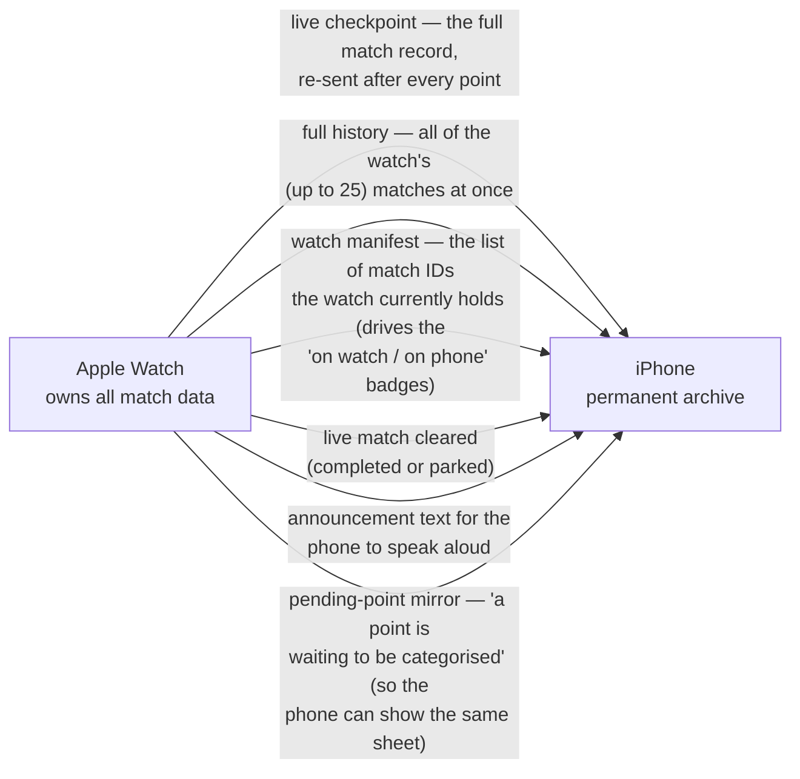
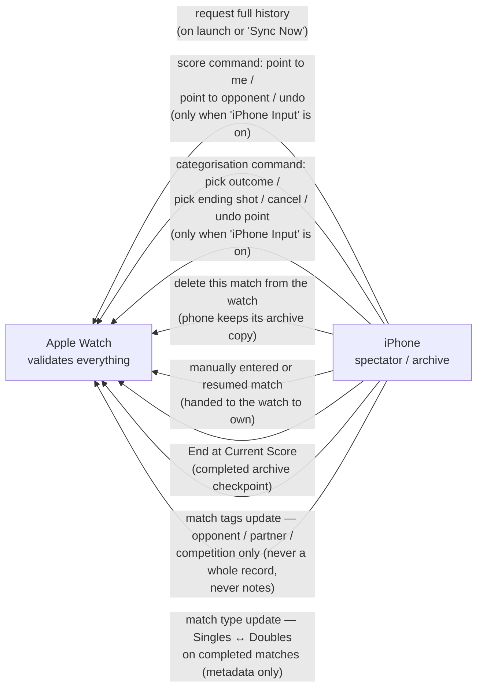
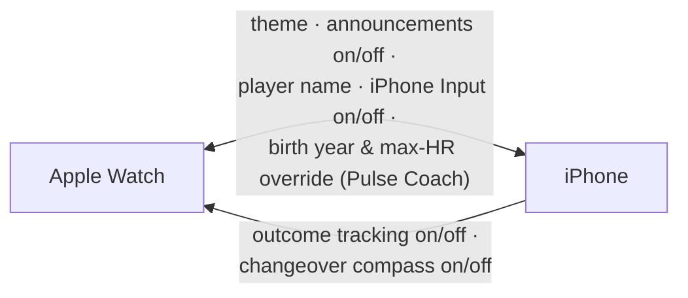
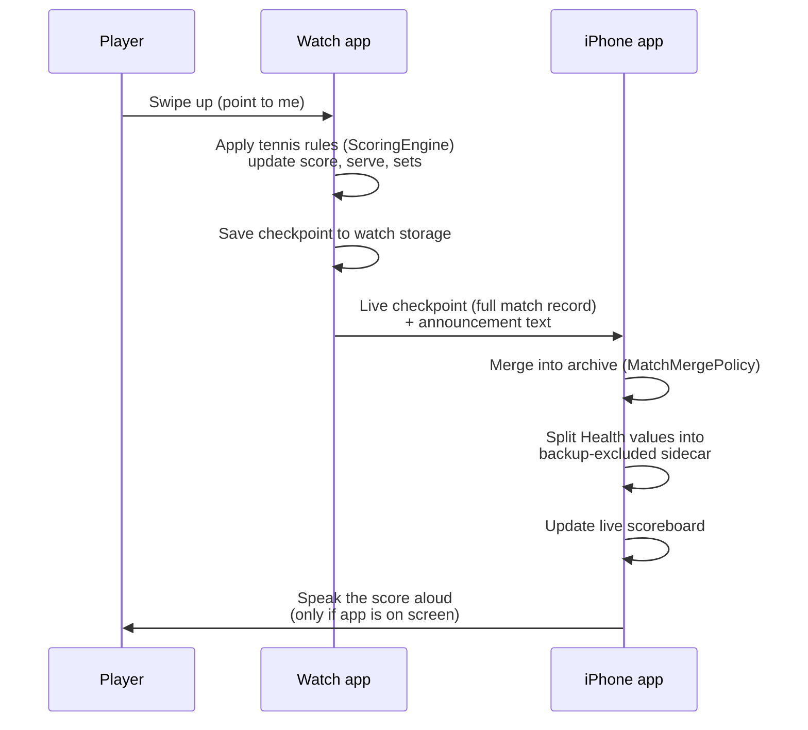
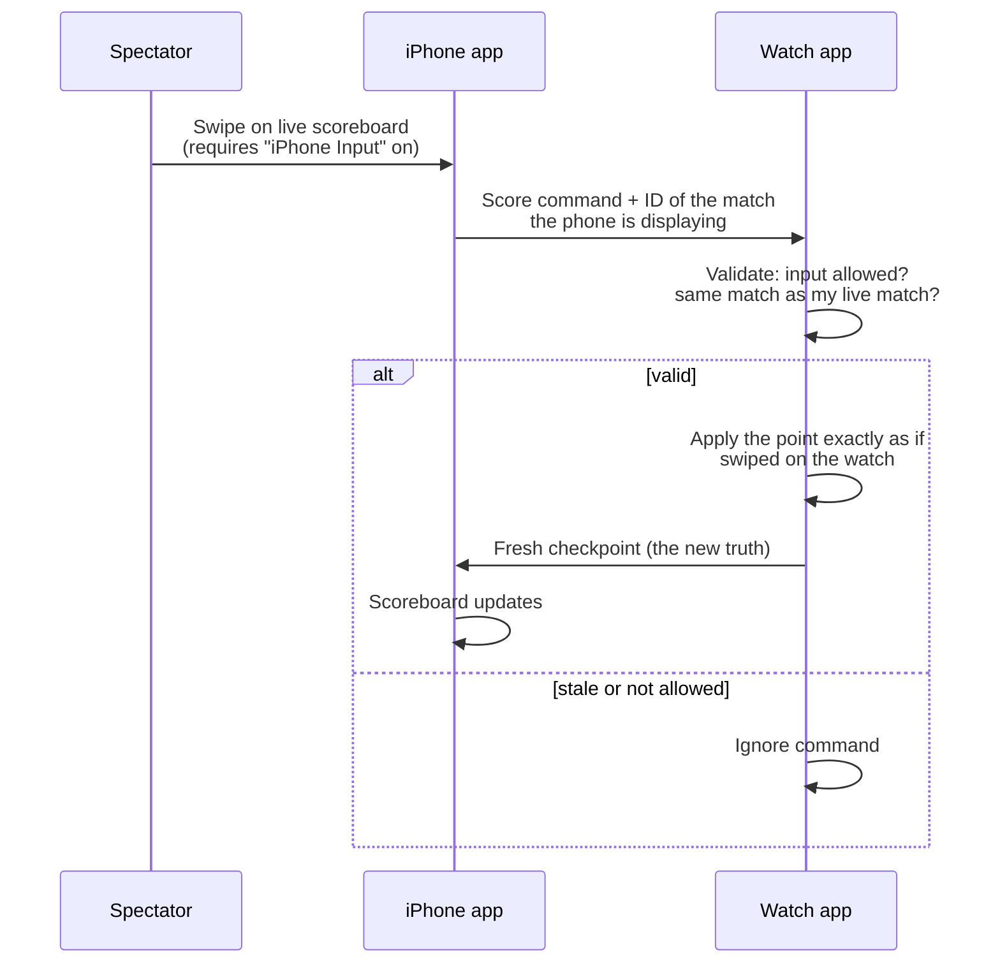
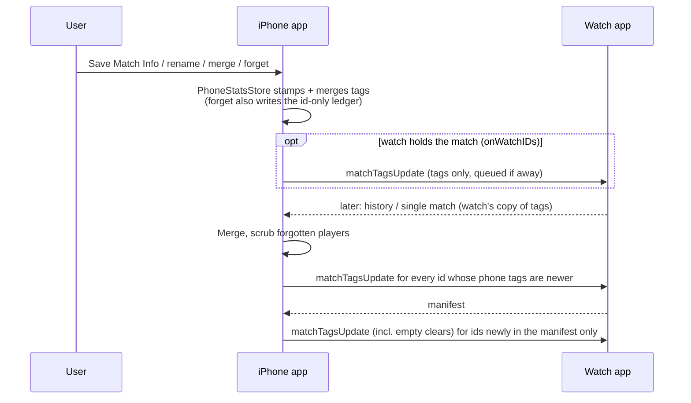

# Sync & Data Flow — what travels between the watch and the phone

Everything between the two apps crosses **WatchConnectivity**, Apple's
watch-to-phone bridge. Each side has one "sync service" file
(`WatchMatchSyncService` on the watch, `PhoneMatchSyncService` on the phone);
the message vocabulary, encoding and merge rules live in the shared package so
both sides are guaranteed to speak the same dialect
(`MatchSyncMessage`, `MatchSyncPayloadBuilder`, `SyncIncomingPayload`,
`MatchSyncTransport`, `MatchMergePolicy`).

The golden rule from the [topology map](README.md): **the watch owns live scoring
and match data normally flows watch → phone.** Phone → watch traffic is requests
and validated commands, plus two explicit archive actions: manual-entry records
and **End at Current Score** completions.

## 1. Match data — one way, watch → phone



Delivery is pragmatic: live checkpoints go instantly when the phone is reachable
(and are silently skipped when it isn't — the next checkpoint supersedes them);
important records are queued so they survive locked screens; large history pushes
go as file transfers. That strategy lives in `MatchSyncTransport`. Commands from
the phone's live scoreboard are the exception to queuing: they are never queued
or retried, the scoreboard blocks them while the Watch is unreachable, and a
failed send shows a short message. A successfully
read full-history request ends with the Watch manifest; an unreadable Watch
archive sends neither history nor a misleading empty manifest. The phone treats
a received manifest as the successful acknowledgement even when it is empty,
because the transport intentionally sends no history file for an empty Watch
archive. The Sync Now result shows both device counts; if the iPhone has archived
matches and a fresh Watch has none, it directs the user to open a match and choose
**Sync to Watch** to restore selected records. Watch pairing/installation changes
are refreshed through `sessionWatchStateDidChange`, rather than remaining frozen
at activation.

## 2. Requests, commands & explicit archive actions — phone → watch



Two safety properties worth knowing as a reviewer:

- **Score commands carry the match ID the phone was displaying.** The watch
  rejects any command whose ID doesn't match its current live match, so a stale
  phone can never score points into a later, unrelated match.
- **A phone completion is identity-scoped.** A parked Watch checkpoint accepts
  the completed version. If the same ID is still live, the Watch completes its
  newer current score and sends that authoritative version back; a different
  live match is untouched.
- **All of this is gated by the "iPhone Input" setting.** Off by default; with it
  off, the phone cannot score the live match. End at Current Score remains an
  explicit archive action with its own confirmation.

## 3. Settings — synced, last-write-wins



Most settings travel both ways and the most recent change wins. Two are
watch-behaviour switches sent phone → watch only. (A third wire key,
`workoutSessionEnabled`, exists in the vocabulary but is currently **dead**:
nothing sends it and both receivers deliberately ignore it — the workout always
runs with a match. A future PR claiming to add a workout toggle must wire that
key end-to-end, not merely flip a value.) One caution flagged in
`CLAUDE.md`: each setting's name exists as a plain text string in two or three
places that the compiler doesn't connect (the wire key, the watch's storage, the
phone's storage) — so a PR that touches a synced setting should show the same
key string updated everywhere, or it will *look* fine and silently fail to sync.

## 4. Two conversations, step by step

**A point is scored on the watch** (the everyday flow):



**A spectator scores from the phone** (the gated flow):



Note the shape of the second flow: the phone never updates its own scoreboard
from the swipe — it waits for the watch's checkpoint to come back. The watch's
record is always the truth.

**An archived in-progress match is ended from the phone** (the explicit exception):

```mermaid
sequenceDiagram
    participant U as Player
    participant P as iPhone archive
    participant W as Watch app
    U->>P: Confirm End at Current Score
    P->>P: Complete stored checkpoint<br/>(draw if level)
    P->>W: Reliable completed record<br/>(retained during activation; queued if unreachable)
    alt same identity is live on Watch
        W->>W: Complete newer live score
        W->>P: Send authoritative completion
    else identity is parked on Watch
        W->>W: Replace checkpoint with completion
    else match is phone-only
        P->>P: No Watch update needed
    end
```

## 5. Merging, deleting, and why deleted matches stay deleted

When a match record arrives on the phone, `MatchMergePolicy` decides what to keep:

1. **Never seen this match before** → store it.
2. **Incoming is finished, stored copy was in-progress** → the finished one wins.
3. **Incoming is in-progress, stored copy is finished** → keep the finished one
   (a late-arriving live checkpoint can never "un-finish" a match).
4. **Both finished** → keep the one that ended later.
5. **Both in-progress** → always accept the incoming one — the watch is the live
   source of truth (this also makes undo work: the reverted state replaces the
   old one even though it has fewer points).

**Match tags and post-completion match-type conversions merge separately.** Those five rules pick the record *body*. The
optional `tags` (opponent / partner / competition type, `MatchTags`) and optional `matchTypeRevision` (completed-match `Doubles ↔ Singles` conversions, `MatchTypeRevision`) then merge by
their own `updatedAt` + `revisionID` clocks on **every** path, whichever body won
(`MatchTags.merged` followed by `MatchTypeRevision.merged`, called inside `MatchMergePolicy.resolve` and
`ArchiveBackupPolicy.resolveBackup`). This matters because a finished match has
the same `endTime` on both devices: rule 4 picks the watch's copy, and without the
separate metadata clocks its untagged / unconverted body would silently wipe the phone's tags or revert a Singles ↔ Doubles conversion on the
next history push. `tags == nil` means "this copy has no tag information" (an
older build re-encoded it); a clear is an *empty* tags value with a newer clock. Likewise, `matchTypeRevision == nil` means `matchType` was never edited post-completion; converting to Singles deterministically trims any partner or second opponent on `tags`.
Tag and match-type edits travel phone → watch on their own `matchTagsUpdate` / `matchTypeUpdate` keys (never as a
`.singleMatch` record, whose watch handler can complete a live match), and
`MatchTags.pendingWatchUpdates` / `MatchTypeRevision.pendingWatchUpdates` resend any updates the watch is behind on when its
history or a newly held manifest id arrives. Forgotten players
(`ForgottenPlayerLedger`) are scrubbed from every inbound record — watch sync,
initial iCloud restore, manual import — regardless of timestamps. Private notes
are never part of a record and never sync. See `docs/features/MATCH_TAGS_PLAN.md`.

**iPhone wiring (match details).** Tags are edited only on the iPhone, for
completed *and* in-progress archived matches; a tag edit never changes the score
or completion state. `PhoneStatsStore.updateTags` stamps the editor's draft against
the stored revision on the store queue (a strictly later clock even if the device
clock went backwards; an empty draft becomes an explicit clear), and
`appendMatch`/`saveHistory` carry stored tags forward so End at Current Score from a
stale copy cannot drop them. The phone then pushes `matchTagsUpdate`:



An incoming `matchTagsUpdate` (v1 watches never author one) is merged by the same
clock; if the phone's copy is newer — a stale echo or a forgotten-player scrub —
the phone answers with its own. Cached watch-mirror rows are scrubbed of forgotten
players before display. The forgotten-player ledger is persisted next to the
tombstones (`forgottenPlayers.json`, ids only), written before the archive,
re-applied on load, and backed up to iCloud with it; initial restore unions the
backup's ledger.

**Tombstones:** when the user permanently deletes a match on the phone, its ID is
remembered in a small "tombstones" list. Any future sync from the watch skips
tombstoned IDs — so a deleted match can never be resurrected by the next history
push. Deleting from the *watch only* ("free up watch space") is different: the
phone keeps its copy and just updates the match's location badge.

**Location badges:** the watch periodically reports the list of match IDs it
holds (the *manifest*). Comparing that list with the phone's archive
(`MatchStorageLocation`) yields each match's badge: on **both** devices, on the
**phone only** (rolled off the watch's 25-match cap, or removed to free space), or
on the **watch only** (deleted from the phone, still visible via the phone's
mirror of the watch — `WatchMirror`).

## 6. Manual archive export / import (iPhone Settings → Backup & Transfer)

Separate from both watch→phone sync (§1) and the one-way iCloud backup, the
iPhone exposes a user-driven **archive file** round-trip in
Settings → Backup & Transfer. The file format and the import rules are pure logic in
`ManualMatchArchiveBackup` (Core); the view (`SettingsView`) only drives the
document picker and the confirmation dialogs, persisting through
`PhoneStatsStore.importManualArchive`.

> The manual archive is one of several health-bearing surfaces gated by a
> per-export consent disclosure. For the full picture of where HealthKit data is
> stripped, excluded, or gated across the whole app, see
> [health-data-flow.md](health-data-flow.md).

- **Export Match Archive** writes a versioned JSON document
  (`format: "deucemate.matchArchive"`, `schemaVersion: 1`) of the phone's
  records, newest-first. Unlike the iCloud backup snapshot — which strips the
  five HealthKit-derived fields to comply with App Store Review Guideline
  5.1.3(ii) — a manual export is **full-fidelity**: it keeps heart rate, steps,
  distance, and calories. That is why the two codecs are deliberately kept
  separate (`ManualMatchArchiveBackup` vs `ArchiveBackupPolicy`).
- **Import Match Archive** first decodes and validates the file (wrong format or
  an unsupported schema version is rejected with a clear error) and shows a
  preview — record count, whether health data is included, and the export date.
  The user then picks one of two modes:

  - **Merge** — union by match id. Records new to the phone are added; for an id
    already present, the same `MatchMergePolicy.resolve` rules from §5 pick the
    winner (finished beats in-progress, the newer finish wins, etc.). Then any
    `nil` HealthKit-derived fields on the kept record are **backfilled** from the
    imported copy (`MatchRecord.fillingMissingHealthData`) — so a merge never
    loses recorded health data even when the existing record is the one kept.
  - **Replace** — the phone archive becomes exactly the imported records;
    matches currently on the phone but absent from the file are dropped. The UI
    guards this behind a second, destructive confirmation. Dropped records are
    **not** tombstoned (unlike a phone-side delete, §5), so a dropped match that
    still lives on the paired watch reappears on the next watch→phone sync —
    Replace makes the *iPhone* archive equal to the file, not the whole
    watch + phone system.

- **Both modes un-delete:** any imported id that was previously tombstoned has
  its tombstone removed (`tombstones.subtracting(incomingIDs)`), so importing a
  match you had deleted brings it back. The result is always sorted newest-first.
- **Forgotten players stay forgotten:** the file may carry an optional
  forgotten-player ledger (ids only). In both modes it is unioned with the
  phone's ledger — an older file without one cannot erase it — and every
  resulting record is scrubbed of forgotten players. In Merge mode, tags merge
  by their own clock (§5), so an older export cannot drop newer tags. Export
  writes the phone's ledger into the file.
- **Private notes are never in the file.** They live in the iPhone-only,
  backup-excluded `MatchNotesStore` sidecar. Merge leaves every note alone; a
  confirmed Replace keeps notes only for matches in the file, and the Replace
  confirmation states how many notes on other matches will be deleted
  (`MatchNotesPolicy.replacePlan`). Permanently deleting a match also deletes its
  note.

This flow only ever writes the **phone** archive (via the same `adoptOnQueue`
funnel as any other mutation): it does **not** push to the watch, and the watch
stays the source of truth for live matches (§1). Because it goes through the
normal funnel, full records remain in memory while `HealthSidecarPolicy` writes
a health-stripped `matchHistory.json` and a backup-excluded Health sidecar. The
stripped result is subsequently pushed to the iCloud backup on the usual
debounced schedule — so a Replace also overwrites the previous iCloud backup
once it lands. A full-fidelity manual import can repopulate missing sidecar data
after an automatic restore.


## Animated guide has no sync route

The watch walkthrough uses a disposable Core `WalkthroughSession` and shared
value/callback displays. It constructs no `MatchRecord` or transport payload,
registers no remote-command handler, and never sends a live checkpoint, archive,
announcement or clear-active signal. Normal app launch bookkeeping and production
remote messages continue independently. If a real session becomes active while
the guide is presented, Home dismisses the guide without changing the real match.
The two version flags remain watch-local; the current theme is read through the
normal environment. See the separate branch in [match-lifecycle.md](match-lifecycle.md).
