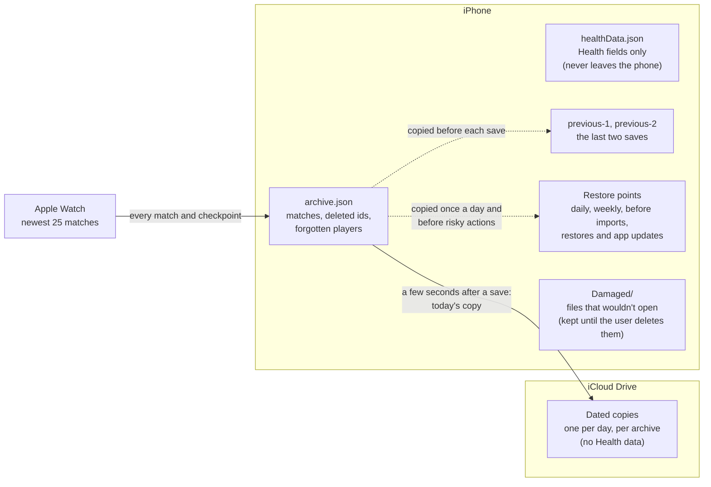
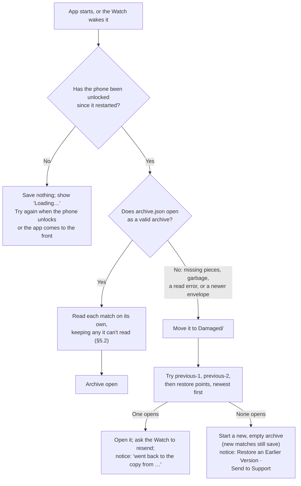

<!--
machine-readable summary (parse this block first)

status: deferred (2026-11-23). Kept as a reference; the next step for #18 is ARCHIVE_DERISK_PLAN.md.
author: Claude, from the owner's review of the #222–#237 archive-safety work
date: 2026-11-23
supersedes: "the #228–#234 containment design (removed by the reset PR, #239) and ARCHIVE_SNAPSHOTS_PLAN.md"
feature: "Make a damaged, unreadable or newer-format iPhone archive harmless by construction, instead of detecting and blocking every bad state."
rules:
  - "R1 Nothing automatic destroys the last good copy of a match."
  - "R2 A match the app can't read is kept unchanged."
  - "R3 New matches always save (except before the first unlock after a restart, when iOS blocks all protected file access)."
  - "R4 A permanent delete or forget reaches every copy the app keeps."
  - "R5 Health data stays on this iPhone."
  - "R6 The app says what it did, and a failed save changes nothing."
components:
  - "archive.json: matches + deleted ids + forgotten players in one versioned file, one atomic write (Health stays in its own file)"
  - "Match-by-match reading that keeps unreadable matches as raw JSON and writes them back unchanged"
  - "previous-1/previous-2 (last two saves) plus dated restore points on the iPhone"
  - "Opening order with automatic fallback; damaged files moved to Damaged/, never deleted automatically"
  - "Dated, compressed iCloud copies in one folder per archive; earlier days are never rewritten"
  - "One notice on the Matches screen"
not_doing:
  - "Any pause of saving, exports or Watch deliveries"
  - "An upload guard, a baseline manifest, a withheld state, Bring Them Back, Remove from Backup"
  - "Writing several files in a set order with rollback"
  - "A database rewrite"
states: "Loading | Open | Opened an earlier copy | Started fresh — plus a count of kept matches (closed list, §7)"
phases: "(a) Core format, reader and retention rules; (b) iPhone archive.json, restore points, fallback, notices; (c) iCloud dated copies; (d) cleaning on delete/forget and privacy text. None started."
decisions_open: [D1, D2, D3, D4, D5, D6, D7, D8, D9]
-->

# Plan: Archive safety, making bad files harmless

> **Deferred (23 November 2026).** The next step for TECHNICAL_DEBT #18 is
> [`ARCHIVE_DERISK_PLAN.md`](ARCHIVE_DERISK_PLAN.md). This plan stays as a
> reference for the problems that plan leaves open. It is not scheduled.

**Status: proposal. Nothing here is implemented.** No phase starts until the owner
has signed off on the architecture (§3–§12).

**Replaces:** the containment design built in #228–#234, which the reset PR
(#239) removed, and [`ARCHIVE_SNAPSHOTS_PLAN.md`](ARCHIVE_SNAPSHOTS_PLAN.md).
This plan absorbs that plan's retention and privacy analysis.

**Read with:** [`TECHNICAL_DEBT.md`](TECHNICAL_DEBT.md) #18, #19 and #4a (the
diagnosis), and [`ICLOUD_BACKUP_HARDENING_PLAN.md`](ICLOUD_BACKUP_HARDENING_PLAN.md)
(why the iCloud backup is one-way and contains no Health data).

---

## 1. Why there is a new plan

TECHNICAL_DEBT #18 found a real bug in 1.4.0. If the iPhone can't decode
`matchHistory.json`, it does three things:
- moves the file aside (`.corrupt`);
- shows an empty archive;
- at the same launch, writes that empty archive over the iCloud backup.

One unknown value in one point of one old match is enough to trigger this. The
moved-aside file survives on the phone, but the backup does not.

Between 21 and 23 November 2026, fifteen PRs numbered from #222 to #237 tried to fix this by
detecting every dangerous situation and blocking it. They added:
- a pause that stopped all saving;
- an iCloud upload guard with a per-account record of what the backup should hold;
- a "withheld" state for when the guard refused an upload;
- six recovery actions and four notices.

Each review found another combination of states that wasn't handled, and each
fix added another state. The work never converged, so the reset PR (#239) put
the iPhone archive code back to 1.4.0. It kept the parts that stood alone: #229's
version-aware readers and Watch fixes, and #228's enum tests.

This plan takes the opposite approach: **make the bad situations harmless by
construction**, so there is little to detect and nothing to block.

| The #228 approach | This plan |
|---|---|
| One iCloud copy, overwritten on every save, with a guard checking each upload | Dated iCloud copies. An upload can't touch an earlier day's copy |
| One bad match makes the whole file "damaged" | One bad match is kept as it is; the rest load normally |
| A damaged file pauses all saving until the user acts | A damaged file is set aside; the app opens the newest good copy and carries on |
| Matches, deletions, forgotten players and Health in four files, written in a set order with rollback | Matches, deletions and forgotten players in one file and one write. Health stays separate |

---

## 2. What can actually go wrong

| | Cause | How likely | What 1.4.0 does |
|---|---|---|---|
| A | A match contains a value this version doesn't know: a newer app wrote it, or someone removed an enum case by mistake | Low now, and rising with every new enum case. The Watch and iPhone apps update separately, so mixed versions are normal | Treats the whole file as damaged, shows an empty archive and overwrites the iCloud backup |
| B | The file isn't valid JSON (a storage fault or a bug) | Very low, because saves are atomic | Same as A |
| C | The file can't be read yet: iOS keeps files locked until the first unlock after a restart | Happens, but only when the Watch wakes the app in the background | Saves nothing for the rest of that run. If the app stays running, the archive shows empty until it restarts |
| D | The data is valid but wrong: a bug, or a Replace import of the wrong file | Low | No way back except the Watch's newest 25 matches |
| E | The phone is lost or replaced | Normal | Offers a fresh-install restore from iCloud |
| F | A save fails, for example because the disk is full | Very low | Most changes still appear on screen but are gone after a restart (TECHNICAL_DEBT #4a). Match-detail edits already roll back |

---

## 3. The six rules

These rules are the acceptance criteria for every PR in this plan, and the only
basis for blocking one (§14).

1. **Nothing automatic destroys the last good copy of a match.** Opening,
   saving, syncing and backing up may add copies. None of them may overwrite or
   delete the only readable copy of a match. Only the user's own Delete
   Permanently or Forget Player removes data, and only on purpose.
2. **A match the app can't read is kept unchanged.** It stays in the archive
   byte for byte, is written back unchanged on every save, and is counted on
   screen.
3. **New matches always save.** A damaged file never stops the iPhone from
   saving new matches or accepting them from the Watch. The one exception is §2
   C: before the first unlock after a restart, iOS lets no app read or write
   protected files. The Watch keeps those matches and sends them again.
4. **A permanent delete reaches every copy.** Deleting a match or forgetting a
   player removes it from the archive, the iPhone's restore points and the
   iCloud copies.
5. **Health data stays on this iPhone.** The five HealthKit-derived fields never
   go to iCloud (App Store guideline 5.1.3(ii)) or into restore points. They
   leave the phone only in a manual export the user confirms.
6. **The app says what it did, and a failed save changes nothing.** Falling back
   to an earlier copy, setting a file aside and keeping an unreadable match are
   all explained in plain words. A save that fails leaves the archive and the
   screen as they were.

---

## 4. The architecture in one picture



In normal use, data still flows one way: Watch → iPhone → iCloud. iCloud copies
and restore points are read only when the user restores (§5.7), or automatically
when the archive won't open (§5.5).

---

## 5. The parts

### 5.1 One archive file, one write

1.4.0 writes four files on every save, in a set order: forgotten players, Health,
matches, deleted ids. A crash between two of those writes can leave a new file
next to an old one. This plan puts matches, deleted-match ids and forgotten
players in **one** file, `archive.json`, saved with one atomic write. After a
crash you have either the old file or the new one, never a mix.

Health stays in its own backup-excluded file (`healthData.json`), because
Apple's rules require it. It only holds a copy of HealthKit data, and heart rate
can be fetched from HealthKit again. If a save is interrupted between the two
files, the worst case is that the newest match is missing its Health detail.

`archive.json` is a versioned envelope (TECHNICAL_DEBT #19). It holds `format`,
`schemaVersion`, `archiveID` (§5.6), `savedAt` and the app version, then the
three lists. The version is checked before anything else is decoded, the same
way #229's `PersistedArchiveCodec` does it.

**Policy: the envelope version never goes up in a way older apps can't read.**
The file changes the way `MatchRecord` already does, by adding optional fields.
New enum values are handled one match at a time by §5.2.

### 5.2 Read one match at a time, and keep what can't be read

Each match in the file is decoded on its own. When this version can't decode a
match:
- the match is kept as raw JSON and written back unchanged on every save;
- its id is still read where possible, with a tiny id-only decoder, so deletions
  and sync can refer to it;
- it isn't shown in the list, but it is counted: "1 match needs a newer version
  of DeuceMate".

Watch deliveries follow the same rules (D9):
- If the Watch sends a match the iPhone can't read and doesn't already have, the
  iPhone keeps it raw.
- If the iPhone already has a readable copy of that match, the unreadable one is
  ignored. The Watch still holds it, and an updated iPhone will take it.
- If the archive holds a kept (unreadable) copy and the Watch sends a readable
  one with the same id, the kept copy wins. A newer app wrote it, so it is at
  least as recent.

Protocol Buffers handle fields they don't recognise the same way. This removes
the reason #18 gave for refusing lenient reading, which was that the next save
would make a skipped match's loss permanent. Here nothing is skipped.

### 5.3 Saving: disk first, last two saves kept

Every change follows the same order:

1. Build the new archive in memory.
2. Copy the current `archive.json` to `previous-1`, after first copying
   `previous-1` to `previous-2`. On APFS these copies are instant.
3. Write the new `archive.json` atomically.
4. Only after that: update the screen, tell the Watch, delete a note, schedule
   the iCloud copy.

If step 3 fails, nothing after it happens:
- the screen still shows the old archive;
- a user action says "Couldn't save. Nothing has been changed.";
- a Watch delivery is left for the Watch to send again.

There is no rollback to get wrong, because nothing changes before the write
succeeds.

`previous-1` and `previous-2` have one job. If the newest save is damaged, the
one before it is only seconds old.

### 5.4 Restore points on the iPhone

The last two saves don't help with data that is valid but wrong (§2 D), because
a bad state replaces both within two saves. Restore points are therefore taken by
time and by intent, not on every save:

- **Daily:** a copy of the archive as it was, taken before the first save of
  each day.
- **Before risky actions:** a copy taken just before a Replace or Merge import,
  a Restore an Earlier Version, or a first-launch restore. If it can't be
  written, the action doesn't run.
- **Before an app update:** a copy taken at the first launch of each new app
  version. A new build is the likeliest source of a bad merge.

Retention is a pure Core rule:
- keep the newest point from each of the last 7 days;
- keep the newest point from each of the last 4 weeks;
- keep the last 3 before-action points, including before-update ones, for 30
  days;
- delete the rest, but never the newest point;
- prune nothing while either archive notice from §5.9 is showing ("went back"
  or "couldn't be opened"). The footer line about kept matches doesn't pause
  pruning.

Restore points live in `Application Support/MatchArchive/RestorePoints/`. They
are compressed and excluded from device backups, since they duplicate the
archive. They contain no Health data, because `archive.json` doesn't.

### 5.5 Opening the archive



Three things keep this simple:
- **A damaged file is moved, never deleted**, so falling back loses nothing that
  was readable.
- **Falling back happens automatically**, because the result is never worse than
  refusing to open. The previous save is seconds old, and the Watch resends its
  newest 25 matches.
- **"Not unlocked yet" means waiting, not failing.** iOS reports when protected
  data becomes available, and the app tries again then. 1.4.0 gave up until the
  app restarted. Any other read error counts as damage, so no state is left
  without a way out.

A file with a newer envelope version can only appear after a developer
downgrade, because of the §5.1 policy. It is treated as damaged: moved to
`Damaged/` and kept.

A missing `archive.json` counts as damage when any earlier copy exists. If no
earlier copy exists either, there are two cases:
- **A brand-new install:** this is a first launch, not damage. The app creates a
  new archive and offers the iCloud restore as today (§5.7).
- **An update from 1.4.0:** the app migrates the three 1.4.0 files (§6, row
  14).

### 5.6 iCloud copies

The iCloud backup changes from one copy, overwritten on every save, to **dated
copies**:

```
iCloud Drive (app container)/
  Archives/<archiveID>/
    2026-11-23.archive    today's copy, updated a few seconds after each save
    2026-11-22.archive    never written again (except §5.8 cleaning)
    …
  matchHistory.json, deletedMatchIDs.json, forgottenPlayers.json
                          the 1.4.0 copy: left in place, read-only (D8)
```

- **One copy per day, per archive.** Today's copy is updated after each save,
  just as 1.4.0 updates its single copy. Earlier days' copies are never written
  again, except to remove a deleted match (§5.8). At worst a bad state damages
  today's copy, and yesterday's survives.
- **A folder per archive.** Each archive gets a random `archiveID` when it is
  created: on a new install, or when §5.5 starts a fresh archive. A restore
  keeps the current id. A new phone, a second phone or a fresh start after damage
  therefore writes into its own folder and can never overwrite another archive's
  copies. This is what replaces the old upload guard, its per-account record and
  the "withheld" state.
- **Retention:** keep the newest copy from each of the last 7 days and from each
  of the last 4 weeks. Never delete the newest copy of any folder. Each install
  prunes its own archive's folder. A folder nobody has written to for 30 days is
  cut down to its newest copy.
- **Same content as today:** no Health fields (`ArchiveBackupPolicy` strips
  them), with deleted ids and forgotten players included.
- **Compressed** with LZFSE, which is in Foundation, so no new dependency. Sizes
  are in §11.
- **Still one-way.** iCloud is read only when the user restores (§5.7), never in
  normal use, and the UI never waits for it.
- **Account switches need nothing special.** Each iCloud account has its own
  container, and nothing is ever overwritten.

The three 1.4.0 files in the container root are never written again. They
appear in the restore list as "Backup from an earlier version of DeuceMate", are
cleaned of deleted matches (§5.8), and are removed after 90 days (D8).

### 5.7 Restoring

One screen, **Restore an Earlier Version**, reached from Settings › Backup &
Transfer and from the notices. It lists restore points on this iPhone and iCloud
copies, newest first. Each row shows the date, where the copy is, how many
matches it holds and how many need a newer version.

A copy can be applied in two ways (D4):
- **Add Missing Matches** (the default) merges by id with the normal merge
  rules. Nothing on the phone is removed, so it can't make things worse.
- **Replace with This Version** (confirmed, shown in destructive style) undoes a
  bad import or a bug. A before-action restore point is taken first, so a
  Replace can itself be undone.

Both apply the *current* deleted ids and forgotten players, so a restore never
brings back a match the user deleted or a player they forgot. Health detail is
merged back from the current `healthData.json` (`HealthSidecarPolicy.merge`), so
a restore never drops Health detail the phone still has.

**First launch on a new phone** keeps the current flow: ask before restoring,
merge, never make the UI wait. It now offers the newest copy, with "Choose
another…". Because the new archive writes into its own iCloud folder, uploads no
longer have to wait for the user's answer.

### 5.8 Deleting and forgetting

Delete Permanently and Forget Player update `archive.json` as today: the match is
removed and its id recorded, or the player is removed and recorded. Then, in the
background, every restore point and every iCloud copy the app can read is
rewritten without that match or player. A copy that can't be read or rewritten is
left alone and drops out through retention (§10).

Damaged files aren't rewritten, because they can't be parsed reliably. Settings
lists them, with **Send to Support** and **Delete** (D6).

### 5.9 What the user sees

The Matches screen shows at most one notice:

| Situation | Notice | Buttons |
|---|---|---|
| §5.5 fell back to an earlier copy | "Your match archive couldn't be opened, so DeuceMate went back to the copy saved at 14:02 today. Matches still on your Apple Watch are being sent again." | OK · Send to Support |
| §5.5 found nothing that opened | "Your match archive couldn't be opened. The damaged copy has been kept, and new matches will save as normal." | Restore an Earlier Version · Send to Support · OK |
| §5.2 kept matches | A line in the list footer: "1 match needs a newer version of DeuceMate." | Update (App Store) |
| An upgrade found readable matches in a file 1.4.0 had set aside (D7) | "DeuceMate found 12 matches that an earlier version couldn't open." | Add Them Back · Not Now |

**Send to Support** opens the share sheet with the damaged file attached. The file
holds names and scores but no Health data (§5.1). The iCloud status line keeps
its six 1.4.0 states. There is no "paused" state.

---

## 6. Every situation, and what happens

This table is also the test list (§15).

| # | Situation | What happens | Rules |
|---|---|---|---|
| 1 | One match uses a value this version doesn't know | It is kept unchanged and the footer says so; everything else works normally | 2, 3, 6 |
| 2 | A newer Watch sends a match an older iPhone can't read | The iPhone keeps it raw, unless it already has a readable copy; the rest of the sync goes through (D9) | 1, 2, 3 |
| 3 | The newest save is damaged | It is set aside, `previous-1` opens, the Watch resends, and a notice explains | 1, 3, 6 |
| 4 | Every local copy is damaged | Restore points are tried; if none opens, a fresh archive starts and the notice offers iCloud | 1, 3, 6 |
| 5 | The Watch wakes the app before the phone's first unlock | Nothing is read or saved. Loading is retried on unlock, and the Watch resends | 1, 3 |
| 6 | A bug or a wrong Replace leaves valid but wrong data | The user restores a restore point or an iCloud copy, adding or replacing | 1, 6 |
| 7 | A save fails | Nothing changes on screen; user actions say so; the Watch resends its deliveries later | 6 |
| 8 | iCloud is signed out, switched to another account, or still downloading | The archive works locally, copies go to the active account, and the restore list shows "downloading" | 1 |
| 9 | An iCloud copy is unreadable, or from a newer version | It is listed as such and only ever removed by retention | 1, 2 |
| 10 | New phone or reinstall | The user is asked to restore the newest copy, or to choose another | — |
| 11 | Two iPhones on one iCloud account | Each archive writes to its own folder | 1 |
| 12 | Delete Permanently or Forget Player | The archive is updated, then restore points and iCloud copies are cleaned | 4 |
| 13 | A manual export is imported | A before-action restore point is taken, then Merge or Replace runs as today | 1 |
| 14 | First launch after updating from 1.4.0 | The three files become `archive.json`, and a before-update restore point keeps the originals. Any `.corrupt` file moves to `Damaged/`, and its readable matches are offered back (D7) | 1, 2, 6 |

---

## 7. The complete list of states

The store is always in one of four states, and also keeps one count:

| State | Meaning | Ends when |
|---|---|---|
| Loading | The file can't be read yet (§5.5) | It is read, on unlock or when the app comes to the front |
| Open | Normal | — |
| Opened an earlier copy | A fallback worked and its notice is showing | The user dismisses the notice |
| Started fresh | Nothing opened and its notice is showing | The user restores or dismisses |
| *Kept matches (a count)* | Matches this version can't read | An update can read them |

iCloud keeps its six existing status values.

**A change that needs a new state, file or flag must update this plan first, with
the owner's OK.** This is the main defence against another loop (§14).

---

## 8. What stays the same

- **The Watch:** its newest 25 matches and its live-match protection (in 1.4.0
  already), plus the "History Unavailable" screen and the "update the app"
  message for a newer live-match file (both from #229).
- **Private notes:** the notes store and its rules.
- **Manual export and import:** full fidelity, with Health included only when
  the user chooses. The only change is the before-action restore point.
- **Data rules:** merge rules, the tag and match-type clocks, and how deleted ids
  and forgotten players work.
- **Watch–iPhone sync**, apart from D9.
- **One-way flow:** Watch → iPhone → iCloud, and the UI never waits for iCloud.

How this maps to the backlog:
- TECHNICAL_DEBT #18 → §5.1–§5.6
- #19 → §5.1 and D9
- #4a (save failures) → §5.3
- #29 → rule 3 and D9

---

## 9. What we're deliberately not doing

- **A global pause.** No condition stops saving, exports or Watch deliveries.
  §2 C is iOS's lock, not a pause.
- **Guarding uploads.** No upload guard, no record of what the backup should
  hold, no "withheld" state, and no Bring Them Back or Remove from Backup. Dated
  copies make every upload safe.
- **Copying iCloud before a Replace.** Yesterday's copy and the before-action
  restore point already exist.
- **Writing files in a set order with rollback.** There is one file per save.
- **Detecting valid-but-wrong data.** It can't be done in general. Restore points
  are the answer.
- **A database (Core Data, SwiftData or CloudKit).** That would rewrite the whole
  persistence layer to get safety these parts already provide. TECHNICAL_DEBT #19
  reached the same conclusion.

---

## 10. Accepted limitations

These are recorded so reviewers don't chase them:

- **Late discovery:** if bad data is noticed after about 4 weeks, no good restore
  point may be left. The newest copy of each archive is always kept, but daily
  and weekly points age out.
- **Forgetting a player in a kept match:** a kept match (§5.2) can't be cleaned
  of a forgotten player until a version that can read it opens it. The
  forgotten-player list is applied on every load, so this happens on the first
  such load.
- **Damaged files aren't cleaned** by §5.8. They stay until the user deletes
  them.
- **Unreadable iCloud copies aren't cleaned** by §5.8. Retention removes them,
  unless one is the newest copy of its folder.
- **Downgrading the app** (TestFlight) isn't supported. An archive file written
  by a newer version is moved to `Damaged/`, and the older app falls back to an
  earlier copy.
- **Before the first unlock after a restart**, matches arriving from the Watch
  aren't saved on the iPhone. The Watch sends them again (rule 3's exception).
- **An interrupted save** that stops between `archive.json` and
  `healthData.json` can leave the newest match without its Health detail.

---

## 11. Storage cost

Measured on a 47-match test archive (4,059 points): the file is 1.1 MB, about
24 KB per match and 280 bytes per point. It compresses about 6–7 times (measured
with zlib as a stand-in for LZFSE).

| Archive | One copy | Compressed | On the iPhone (2 previous saves + up to 14 restore points) | iCloud (up to 11 copies) |
|---|---|---|---|---|
| 50 matches | ~1.2 MB | ~0.2 MB | ~5 MB | ~2 MB |
| 500 matches | ~12 MB | ~1.8 MB | ~50 MB | ~20 MB |

Phase (a) measures again on a larger test archive before these numbers are
fixed. For comparison, 1.4.0 uploads the whole uncompressed archive after every
save. Compression makes each upload about 6 times smaller.

---

## 12. Decisions for the owner

| # | Decision | Recommendation |
|---|---|---|
| D1 | Put matches, deleted ids and forgotten players in one file | Yes (§5.1) |
| D2 | Retention: 2 previous saves; 7 daily and 4 weekly points; the last 3 before-action points for 30 days; iCloud 7 daily and 4 weekly | Yes, re-checked against §11 in phase (a) |
| D3 | Compress restore points and iCloud copies | Yes |
| D4 | Restoring offers Add Missing Matches (the default) and Replace with This Version | Yes |
| D5 | Delete and Forget clean restore points and iCloud copies, rather than leaving them to age out | Clean them, with ageing out as the backstop, and add a line to the privacy policy |
| D6 | Damaged files stay until the user deletes them, from a Settings row | Keep them, and never expire them automatically: they may hold the only copy |
| D7 | On upgrade, offer to add back readable matches from a file 1.4.0 set aside (`.corrupt`) | Yes |
| D8 | The 1.4.0 iCloud files become read-only, are cleaned on delete and are removed after 90 days | Yes |
| D9 | Watch–iPhone sync reads one match at a time and keeps unreadable ones raw (§5.2) | Yes, in phase (a), using the same reader |

---

## 13. Phases (not started)

Each phase is one PR, and none starts before the owner signs off on §3–§12.

| Phase | Surface | What |
|---|---|---|
| (a) | `[Core]` | The archive envelope (§5.1), with match-by-match reading that keeps raw JSON (§5.2). A reader for the three 1.4.0 files. The retention rules (§5.4, §5.6). The per-match sync reader (D9). The size measurement (§11). Pure code, fully tested, no app change. |
| (b) | `[iOS]` | `PhoneStatsStore` on `archive.json`: migration (§6 row 14), disk-first saves with previous copies (§5.3), restore points (§5.4), the opening order with fallback and retry on unlock (§5.5), the notices and Send to Support (§5.9), and Restore an Earlier Version for local restore points (§5.7). |
| (c) | `[iOS]` | Dated iCloud copies per archive (§5.6), the new first-launch offer, iCloud copies in the restore list, and the 1.4.0 files as a read-only copy. |
| (d) | `[iOS]`, docs | Cleaning on delete and forget (§5.8), the Damaged files row (D6), and the privacy policy and App Review notes text. |

---

## 14. How this work is reviewed

The previous attempt didn't converge, so these rules apply to every PR above:

1. **Review against §3 only.** A blocking finding names the rule it breaks and
   gives a concrete scenario. Any other finding goes on a follow-up list in this
   file and doesn't hold up the PR.
2. **The state list (§7) is closed.** A fix that needs a new state, file or flag
   changes this plan first, with the owner's OK. It is never added inside the
   PR.
3. **At most two review rounds per PR.** After that, the owner decides.
4. **Meet the rules by construction wherever possible:** move instead of delete,
   date instead of overwrite, keep instead of skip. Each PR says how it does
   this.
5. **Docs change in the same PR as the code:** CLAUDE.md, the file inventory and
   the architecture docs, as CLAUDE.md §6 requires.

---

## 15. Tests

- **Core:** every row of §6 that Core can express. That includes an envelope
  round-trip, and a kept match written back byte-identical. It also covers an
  unknown future value in each of the six persisted enums. Retention needs tests
  at its boundaries: daylight-saving changes, week edges, the newest copy always
  being kept, and the clock going backwards.
- **iPhone** (`PhoneStatsStoreTests`, using real files in a temporary
  directory): every row of §6. That includes a failed save that leaves the
  screen unchanged, and the fallback order. It also covers migration from 1.4.0
  files with and without a `.corrupt` file, and cleaning restore points on
  delete.
- **By hand, on a device:** the notice wording, Restore an Earlier Version, a
  first-launch restore on a second device, VoiceOver and Dynamic Type.
