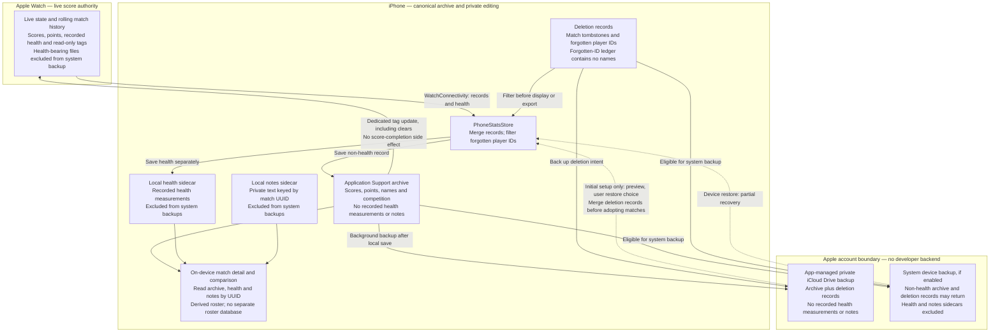
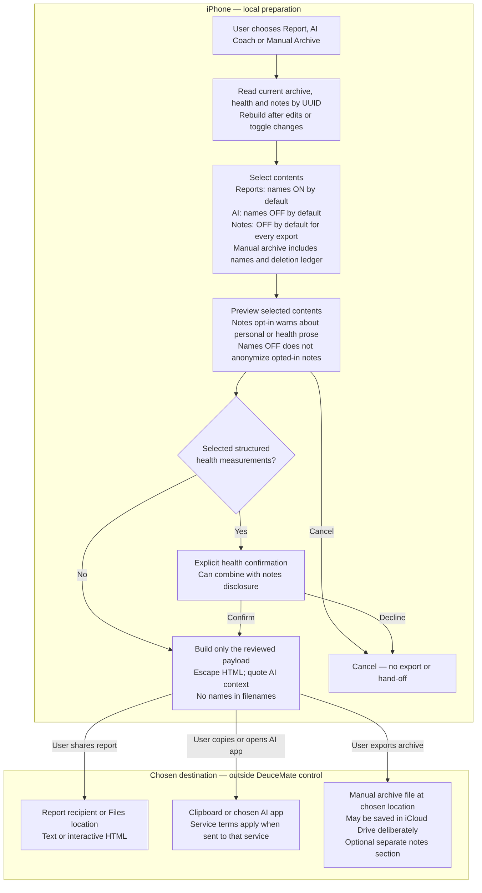
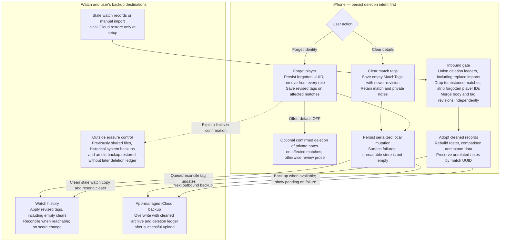

<!--
machine-readable summary (parse this block first)

status: revised after owner-authorized review (2026-10-23; supersedes completed-only scope)
author: Claude, design session with the owner
date: 2026-10-23
feature: "Tag a completed or in-progress match with who was played (selectable roster) and its competition type (Friendly / League / Tournament / Practice); show the tags on the watch; compare with a previous match on iOS; add private local notes; feed selected context into AI Coach and shared reports."
recommendation: "One optional `tags: MatchTags?` field on MatchRecord, edited on iOS, read-only on the watch in v1. The roster of players is DERIVED from the archive (no separate roster database; deletion ledger in §6.2). Tags merge independently of the record body by their own last-write-wins clock, because today's merge rules would silently wipe them. Names are withheld from the AI prompt by default and never put in filenames or spoken announcements."
hard_findings:
  - "MatchMergePolicy.resolve case 4 (both completed) keeps `incomingEnd >= existingEnd ? incoming : existing` (MatchMergePolicy.swift:42). The watch's copy of a finished match has the SAME endTime as the phone's, so the next full-history push (Sync Now, requestFullHistory, ping) replaces the phone's tagged record with the watch's untagged one. `fillingMissingHealthData` backfills only health. Tags MUST merge separately — PR 1 lands before any UI can write a tag."
  - "Three other merge sites have the same shape: ArchiveBackupPolicy.resolveBackup (initial iCloud restore), ManualMatchArchiveBackup.importSnapshot(.merge) (via resolve) and the watch's `.singleMatch` handler (via resolve). WatchMirror.merged replaces by id but is a display mirror of the watch's own copy."
  - "Mixed versions are routine (watch and phone update separately). MatchRecord's custom init(from:) ignores unknown keys, so an old build decodes a tagged record — but re-encodes it WITHOUT tags. So `tags == nil` must mean 'no information', never 'cleared'. Clearing is an empty MatchTags with a newer updatedAt."
  - "`MatchType` already exists and means singles/doubles (ScoreTypes.swift:11, rendered as `matchTypeLabel` in the HTML export). Friendly/League/Tournament needs a different name: `CompetitionType`."
  - "A new persisted enum is additive-only forever (CLAUDE.md §4, TECHNICAL_DEBT #18) and a value an older build doesn't know fails the WHOLE [MatchRecord] decode (#19). CompetitionType is stored as a raw string and exposed as an optional typed value, so a future case degrades to 'unknown' instead of blanking an archive."
  - "Sending a full record to the watch to update tags would go through the `.singleMatch` handler, which calls `onCompletedMatchReceived` → `completeCurrentMatchIfMatching` (DeuceMateApp.swift:60). A dedicated `matchTagsUpdate` wire key avoids that side effect, is tiny, and older watch builds already ignore unknown keys."
scope:
  in_scope:
    - "Core: Models/MatchTags.swift (new), MatchRecord.tags, MatchMergePolicy + ArchiveBackupPolicy tag merge, Stats/PlayerRoster.swift + HeadToHead (new, derived), MatchSyncKey.matchTagsUpdate + payload builder + SyncIncomingPayload event"
    - "iOS: previous-match comparison and completed-only head-to-head summary; backup-excluded local notes sidecar with per-export opt-in"
    - "iOS: tag editor + player picker on MatchDetailView, archive-row subtitle, PhoneStatsStore.updateTags, rename/forget player, push tags to the watch with manifest/history reconciliation (§6.1)"
    - "Watch: persist incoming tags (StatsStore, same serial queue), show them in MatchHistoryView / MatchStatsView"
    - "Exports: AI prompt 'Match Context' section + head-to-head, text export overview lines, HTML meta (schema 13) + static fallback"
    - "docs/website/privacy.html, docs/release/APP_STORE_METADATA.md, docs/architecture/* — in the PRs that ship the behaviour, not in this plan PR"
  out_of_scope_v1:
    - "Tagging on the watch (quick pick after a match) — v2, see §9"
    - "Trends filters by competition / opponent — v2; pairwise comparison and a head-to-head summary ship in v1"
    - "Free-text event / club / venue names — not asked for, adds location-like data"
    - "Contacts framework integration — a permission and a privacy surface for no real gain"
    - "Cloud backup or watch sync of free-text notes — excluded in v1"
    - "Inline tag fields in ManualMatchEntryView — edit immediately after saving from MatchDetailView, with no completion requirement"
decisions: [OQ-1 UI label is 'Competition Type', OQ-2 names in shared reports ON by default with a toggle, OQ-3 iPhone-only editing in v1 (watch read-only), OQ-4 'Practice' included as a fourth case; defaults revised in §11.1 and review table §11.2]
-->

# Plan: Match Details — Player Names, Competition, Comparison and Notes

## 1. The ask

> Tag a finished match with the name of a player, and a match type of
> friendly / league / tournament. Names, once added, should be selectable
> later. Tagging can happen on the watch or iOS, most likely iOS, with
> visibility on the watch. Use the tags in the AI generation prompt and in
> shared reports. Review whether there is sensitive data to think about.

The owner-authorized review on 2026-10-23 extends the original ask: a match
may still be in progress when the user wants to name it, compare it with a
previous match, or add notes. Editing details never completes a match or
changes the watch-owned score. The review decisions below supersede the
original completed-only and deferred-comparison defaults. “Pending” here means the match
remains in progress; it is separate from an iCloud upload/restore status.

### 1.1 The proposal at a glance

| Decision | Choice | Why |
|---|---|---|
| Where tags live | One optional `tags: MatchTags?` on `MatchRecord` | Travels with the match through every existing path (sync, iCloud backup, manual archive) with no separate roster store; forgotten-ID deletion ledger is backed up separately (§6.2). |
| Where you edit | **iOS** match detail, completed and in-progress matches. Watch is read-only in v1. | Typing names on a 45 mm screen is slow; the phone is where the archive is reviewed. |
| "Selectable later" | A **roster derived from the archive** — every distinct tagged player, most recent first. | No separate roster database; deletion intent uses a minimal forgotten-ID ledger. Rename/forget update matching records. |
| Identity | Each player is `{id: UUID, name}`; the id is minted once and reused when picked from the roster. | Two different "Alex"es stay separate; a rename updates every match. |
| Competition Type | `CompetitionType`: `friendly`, `league`, `tournament`, `practice`; shown in the UI as **"Competition Type"** | Not `MatchType` — that name is taken by singles/doubles. |
| Sync | Tags merge by their own `updatedAt` clock, independent of the record body; edits go to the watch on a new `matchTagsUpdate` key. | Today's merge would silently delete tags (§3). |
| AI prompt | Competition + head-to-head record **always**; real names **only if the user opts in**, default off. | Names add nothing to coaching quality and are third-party personal data going to an AI service. |
| Shared reports | Names + competition in the header; filenames never contain names. Notes have a separate opt-in, default off. | Preserve the existing names default while keeping private reflections private. |
| Previous-match comparison | In-app comparison in v1, with a changeable baseline and completed-only head-to-head summary. | Naming should immediately help the user review performance. |
| Notes | iPhone-local sidecar keyed by match UUID, excluded from app-managed iCloud and system backups. | Free text may contain health information; it must not inherit the tags backup policy. |

## 2. What exists today

- `MatchRecord` has `matchType: MatchType` (singles / doubles) and
  `matchFormat`, nothing about who was played or why.
- `playerName` is a **synced setting** (`MatchSyncKey.playerName`, capped at
  128 chars in `SyncIncomingPayload`) holding the *user's own* name for spoken
  announcements. It is not a tag and is not touched by this plan, except that
  exports can use it for the "me" side when names are included.
- The phone can push a whole record to the watch ("Sync to Watch",
  `PhoneMatchSyncService.sendMatchToWatch`), the watch holds at most
  `WatchHistory.cap` (25) records and reports which via `watchManifest`.
- Doubles already models four positions (`DoublesServer`: me, partner,
  opponentS1, opponentS2) for serve rotation; tags do not need to map onto
  those slots.

## 3. The merge hazard (why Core lands first)

`MatchMergePolicy.resolve`, case 4 — both records completed:

```swift
return incomingEnd >= existingEnd ? incoming : existing   // MatchMergePolicy.swift:42
```

A finished match on the phone and the watch has the **same** `endTime`. The
watch re-sends its whole history on Sync Now, `requestFullHistory` and every
`ping`, so the sequence

1. user tags the match on the phone,
2. watch pushes its history (untagged copy, equal `endTime`),
3. `>=` picks `incoming`,

ends with the tag gone, silently. `fillingMissingHealthData(from:)` only
backfills the five health fields. The same body-wins shape exists in:

| Site | Path |
|---|---|
| `MatchMergePolicy.resolve` | phone ← watch sync; manual archive import (`.merge`); watch ← phone `.singleMatch` |
| `ArchiveBackupPolicy.resolveBackup` | one-time initial iCloud restore |
| `WatchMirror.merged` | phone's display mirror of watch-only rows (replace by id) |

**Rule:** resolve the body exactly as today, then set
`result.tags = MatchTags.merged(existing?.tags, incoming.tags)`:

- one side `nil` → the other (nil = "this copy never heard of tags", e.g. an
  older build re-encoded it);
- both present → the later `updatedAt`; on an equal timestamp with differing contents, use a persisted `revisionID: UUID`
  as a deterministic secondary key (lexicographic UUID string order). Keeping
  each receiver's existing value would leave two peers permanently divergent.
  Legacy tags without a revision use a fixed zero UUID; edits mint a new one.

Clearing all tags writes an **empty** `MatchTags` with a fresh `updatedAt`, so
it beats an older non-empty copy instead of looking like "no information".

Apply tag merging on **every return path**, including incoming live checkpoints,
undo and completion, even when the body winner is unchanged. A tag-only payload
must never advance the score, start a workout or complete a match.

Put the call inside `resolve` and `resolveBackup` so every current caller gets
it. Tags are editable only after a record is in the phone archive. A watch-only
row offers Sync to iPhone first. Apply forgotten-ID filtering to watch-mirror
rows too, so a stale display copy cannot expose a forgotten name. On the watch,
later live checkpoints/history saves must preserve stored tags even if the
active scoring snapshot lacks them; audit append/checkpoint/resume paths as well
as incoming `.singleMatch` handling. Score state remains watch-owned.

## 4. Data model (Core)

New file `Models/MatchTags.swift`:

```swift
public struct TaggedPlayer: Codable, Equatable, Hashable, Sendable {
    public let id: UUID
    public var name: String            // sanitized display snapshot
}

public enum CompetitionType: String, CaseIterable, Sendable {
    case friendly, league, tournament, practice
    public var displayLabel: String { … }
}

public struct MatchTags: Codable, Equatable, Sendable {
    public var opponents: [TaggedPlayer]   // 0…1 singles, 0…2 doubles
    public var partner: TaggedPlayer?      // doubles only
    /// Raw storage so an unknown future case round-trips instead of failing
    /// the whole archive decode on an older build (TECHNICAL_DEBT #18/#19).
    public var competitionTypeRaw: String?
    public var competitionType: CompetitionType? {
        get { competitionTypeRaw.flatMap(CompetitionType.init(rawValue:)) }
        set { competitionTypeRaw = newValue?.rawValue }
    }
    public var updatedAt: Date             // tag-only last-write-wins clock
    public var revisionID: UUID            // deterministic tie-break; default zero UUID on decode
    public var isEmpty: Bool { … }
    public static func merged(_ existing: MatchTags?, _ incoming: MatchTags?) -> MatchTags?
    public func sanitized() -> MatchTags   // see below
}
```

`CompetitionType` deliberately is **not** `Codable` itself: nothing persists
the enum, only its raw string. That makes it the first persisted value in the
repo that is forward-compatible by construction rather than by review.

`MatchTags` gets a custom `init(from:)` that uses `decodeIfPresent` with
defaults for every field from day one, so later additions follow §4 of
`CLAUDE.md` without a special case.

`MatchRecord` change — the standard §4 recipe, one field:

1. `public var tags: MatchTags?`
2. memberwise `init(…, tags: MatchTags? = nil)`
3. `tags = try c.decodeIfPresent(MatchTags.self, forKey: .tags)`
4. `MatchRecordCodingTests`: round-trip, old JSON without `tags`, a record
   whose `competitionTypeRaw` is `"ladder"` (unknown) decoding with
   `competitionType == nil` and re-encoding the raw value unchanged.

`strippingHealthData()` leaves player names and competition alone, so they are
in the private iCloud backup copy. Notes are stored separately (§4.1) and never
enter that projection; `HealthSidecarPolicy` remains health-specific.

**Sanitizing** (applied on every input path — UI, wire decode, archive import):
trim, collapse internal whitespace, drop control and newline characters, cap
at 40 characters, drop empty names, de-duplicate by id, cap opponents at 2.
The match-type rule (singles ⇒ ≤1 opponent, no partner) is enforced by the
editor, not by decode — decode must never destroy data an editor wrote.

### 4.1 Private notes — separate ownership and storage

Notes are optional, phone-owned text keyed by match UUID in a new local sidecar
(`MatchNotesStore` on iOS, with a pure Core codec/policy). They are **not** a
stored field on `MatchRecord` or `MatchTags`, and never enter WatchConnectivity,
the automatic iCloud snapshot, the HTML model or an AI prompt implicitly.

- Each entry has `matchID`, `text`, `updatedAt` and `revisionID`; empty text is
  an explicit clear. Use versioned decoding with defaults for additive fields.
- Save serialized mutations atomically with the app's file-protection policy;
  mark the file and containing directory excluded from system backups and
  reapply exclusion after every replacement. Surface save/read failures; an
  unreadable sidecar must never be treated as empty and overwritten.
- The editor allows multiline text up to 4,000 characters, preserves paragraph
  breaks, and strips nonprinting control characters. It has Save and Cancel;
  errors keep the draft open. Tag edits and notes edits persist independently.
- A watch refresh, tag change, match completion, health backfill, or ordinary
  archive import must preserve existing notes for the same UUID. Permanent
  match deletion removes its notes. Replacing an archive requires an explicit
  policy: preserve notes for retained IDs; confirm before discarding notes for
  removed IDs. Never silently orphan or erase them.
- Manual archive export gets **Include private notes**, default off, with a
  preview and explicit disclosure that notes may contain personal/health
  information. Included notes use a separate optional versioned archive section;
  do not project them into the ordinary match JSON. An omitted section means
  no information; an included empty entry means clear. Merge uses the notes'
  own revision order. Import preview states notes counts and merge/replace
  effects, and restores them only to the backup-excluded sidecar.
- Notes do not return automatically after reinstall or migration. State this
  below the editor: "Stored on this iPhone. Not backed up automatically."
  Offer the deliberate manual export route without promising cloud recovery.

## 5. The roster — "selectable in the future"

New `Stats/PlayerRoster.swift`, pure and derived:

```swift
public struct RosterEntry: Identifiable, Equatable, Sendable {
    public let id: UUID
    public let name: String          // from the most recently updated tag
    public let matchCount: Int
    public let lastPlayed: Date
}
public enum PlayerRoster {
    public static func entries(from records: [MatchRecord]) -> [RosterEntry]   // most recent first
    public static func suggestions(_ query: String, in entries: [RosterEntry]) -> [RosterEntry]
}
public enum HeadToHead {
    /// Wins / losses / draws vs a player across completed matches, excluding `excluding`.
    public static func record(vs playerID: UUID, in records: [MatchRecord], excluding: UUID?) -> HeadToHeadRecord
}
```

Why derived rather than a separate roster file:

- the phone archive already has local + iCloud + manual-archive + tombstone
  handling; a second store would need all four, plus its own sync;
- roster entries remain derived; a separate forgotten-ID ledger prevents stale
  copies from resurrecting removed identities (§6.2);
- a player who appears in no match is not someone you need to pick.

Cost: a player added but never saved to a match is not remembered — fine.

**Picker UX (iOS):** a search field over `suggestions`, recent players below it,
and "Add “<typed text>” as new player". When the typed name case-insensitively
matches an existing entry, the existing one is the first suggestion so you
don't mint a duplicate Alex by accident. Same person can be partner in one
match and opponent in another — one id, one roster row.

**Roster management** (Settings → Players): rename (rewrites the name in every
record carrying that id, bumping each `updatedAt`), merge two duplicates
(rewrite id B → A), and **Forget player** (remove from every record). Each is
a single `PhoneStatsStore` mutation through `adoptOnQueue`, followed by tag
pushes for every affected id the watch holds (§6.1).

## 6. Sync

New wire key in `MatchSyncKey`:

```swift
/// JSON-encoded `MatchTagsUpdate { matchID: UUID, tags: MatchTags }`. Bidirectional.
/// Applied only to a record the receiver already holds; merged by `updatedAt`.
public static let matchTagsUpdate = "matchTagsUpdate"
```

- Built in `MatchSyncPayloadBuilder`, decoded in `SyncIncomingPayload` into
  `.matchTagsUpdate(UUID, MatchTags)` (sanitized at decode), round-trip test in
  `MatchSyncRoundTripTests`.
- Sent with `queueOnFailure: true` (`transferUserInfo`) — it is small and
  must survive the watch being away.
- Phone sends it at edit time when `PhoneMatchSyncService.onWatchIDs`
  contains the id (that set includes optimistic ids from records just
  received, not only the last manifest, which can lag). An edit-time send is
  best-effort; §6.1 is what guarantees delivery. "Sync to Watch" of a tagged
  record needs nothing new: the record carries its tags.
- **Watch:** new `StatsStore.updateTags(id:tags:) -> Bool` that reads, merges
  and writes on the store's serial queue and bails when history is unreadable
  (the CLAUDE.md "read failure ≠ empty archive" rule). Do **not** route it
  through `appendMatch` (hides write failures) or `.singleMatch` (fires
  `completeCurrentMatchIfMatching`).
- **Phone:** the same key is handled (watch → phone) so v2 watch editing needs
  no wire change; it applies through `PhoneStatsStore.updateTags`.
- It is not a setting: no `UserDefaults`, so the §0 settings-key grep is
  unaffected.

### 6.1 Reconciliation — eventual delivery to the watch

An edit-time send alone can be skipped for good: the edit can land while the
manifest still lags a record the watch already holds, or the watch can be an
older build that ignores `matchTagsUpdate` and is upgraded later. Nothing would
ever resend. So the phone also reconciles, triggered by the two signals that
say what the watch actually holds:

1. **Watch record bodies** (`.history`, `.singleMatch`). Each carries the
   watch's own copy of the tags. After the merge, any id whose archive tags
   are newer than the incoming copy's (`nil` counts as oldest) gets a
   `matchTagsUpdate`. This is the precise "watch is behind" signal, and it is
   what heals an upgraded watch: its first history push after the upgrade
   still has no tags.
2. **Manifest arrival.** For ids that are in the new manifest but were not in
   the previous one, send any **non-nil** archive tags, including empty clears.
   An empty newer revision is a deletion instruction, not an absence of data.
   This covers both edits and clears made during the manifest lag.

Both checks are a pure Core function,
`MatchTags.pendingWatchUpdates(archive:watchCopies:newlyHeld:) -> [MatchTagsUpdate]`,
tested in `MatchTagsTests`. Resends are idempotent (the watch merges by
`updatedAt`). Diffing the manifest rather than re-sending on every arrival
matters: the watch sends a manifest with every live checkpoint, so a naive
"resend all held tags" would add up to 25 payloads per point during play.

Mixed-version behaviour, checked:

| Phone | Watch | Result |
|---|---|---|
| new | old | watch ignores the unknown key; its history pushes carry no `tags` → merge keeps the phone's. After the watch upgrades, its next history push still has no tags → §6.1 rule 1 resends them. |
| old | new | phone never sends tags; nothing to show. |
| new | new | full behaviour. |

### 6.2 Forgetting players and preventing resurrection

A per-match clear preserves deletion only for known records. An old backup can
also contain a forgotten player on a match no longer held by the phone. Keep a
minimal persistent set of forgotten player UUIDs (no names), separate from the
derived roster. Back it up with the archive and union it on merge **and replace**
imports and initial restore; local deletion intent must survive stale files.

Filter these IDs from every inbound record and tag update **before** roster,
export or UI derivation, regardless of the incoming timestamp. When filtering a
stale watch copy, create/persist a cleaned tag revision and send it back, including
an empty clear. Include the ledger as a versioned optional manual archive field;
old archives lacking it cannot erase the current ledger. A newly re-added person
gets a new UUID. No names are needed in the ledger or logs.

Forget player is one serialized mutation: record forgotten ID, remove it from
all roles, persist the revised tags, then reconcile watch copies and overwrite
the app-managed cloud backup when available. Backup failure leaves a visible
pending state; never promise immediate remote deletion. Already exported files,
Apple-managed historical backups, and older app versions cannot be rewritten.
The confirmation must explain these limits. On a fresh installation, a standalone
old manual backup cannot know about a later forget operation absent from that
backup; preview imported names and explain that recovery boundary.

Notes may also mention the person in prose. Do not promise that forgetting an
ID anonymizes free text or use unreliable name matching. Offer **Delete all
private notes on affected matches**, default off, with the affected count and
confirmation; otherwise direct the user to review those notes.

## 7. Surfaces

### 7.1 iOS

- **MatchDetailView:** a "Match Info" row under the header —
  `vs Alex · League` or `With Sam vs Alex & Jo · Tournament`, "Add opponent &
  type" when empty. Tapping opens a sheet: Competition Type segmented control (Friendly / League / Tournament / Practice), then
  Opponent(s) (+ Partner for doubles) using the picker. Include a "Not set"
  competition choice; use a menu/list if the four labels do not fit at large
  Dynamic Type sizes. Available for completed and in-progress archived records.
  Show an optional Notes preview with a separate editor and local-storage copy
  (§4.1); do not put private note text into archive-row subtitles.
- **PastMatchesView:** the same one-line subtitle in each row (cheap, already a
  `MatchRecord`-driven row; respects the TECHNICAL_DEBT #13 note — put the
  subtitle helper in Core or a small view file, not in `PastMatchesView`).
- **ManualMatchEntryView:** no tag fields — it only creates in-progress
  records. A manually entered match can be tagged and annotated from its detail
  view immediately after saving.
- **Settings → Players:** roster management (§5).

#### Previous-match comparison (v1)

Place **Compare with previous match** directly beneath Match Info / Notes. It
opens a comparison screen with two dated columns and **Choose another match**.
For an untagged current match, offer the most recent earlier completed match of
the same singles/doubles type. With complete opponent identities, prefer the
most recent earlier completed match against the same opponent(s); doubles uses
the unordered opponent pair and the same partner, and explains this pairing.
If none exists, show "No previous match against this opponent" and offer the
same-type archive picker; do not silently label another opponent as a rematch.
Exclude the current UUID. Order by start time with an ID tie-break.

The current record may be in progress. Label it **In Progress — partial stats**;
never infer a win/loss or require End at Current Score to compare or edit.
The picker offers completed baselines by default, with an explicit option to
include in-progress records, each labelled partial. With no prior match, explain
the empty state and keep detail editing available.

Compare score, duration and points tracked, then serving/returning, winners,
unforced errors and double-fault rates using the existing summary denominators.
Show percentages with numerator/denominator (for example, 60% — 12/20), point
coverage and outcome-tracking availability for **each** match. Missing data is
"Not recorded"/a gap, never zero. Rates take priority over raw count differences;
use percentage-point deltas and existing better-direction semantics. Explain
format differences; score-only matches still compare scores/duration without
inventing point metrics. No minimum archive size from Trends gates pairwise
comparison. Derive in Core from the existing summaries, not a second counting pass.

Show completed-only head-to-head wins/losses/draws for identified opponents,
excluding the current match and keeping singles and doubles separate. In doubles,
use the same team identity rule as the baseline; do not pool partner appearances
as opposition. Keep the AI head-to-head scope identical to the on-screen summary.

Resolve both displayed records by UUID from the current store after edits,
syncs, import or deletion. `MatchDetailView` currently takes a value snapshot and
prebuilds exports: invalidate/rebuild those on record, notes or inclusion-toggle
changes. If a baseline disappears, show the picker/empty state. Never share a
cached file containing names or notes after its toggle was turned off.

### 7.2 Watch (read-only in v1)

- `MatchHistoryView` row: one caption line `vs Alex · League` (truncated).
- `MatchStatsView` header: the same line.
- Nothing during live play.

### 7.3 Exports

| Export | Adds | Names |
|---|---|---|
| AI Coach prompt (`MatchExporter.aiPromptExport`) | `## Match Context`: competition, singles/doubles, head-to-head ("vs this opponent: 3–2 in 5 matches; last 3: W W L") | **Off by default.** "Include player names" toggle on `AICoachSheet`; off ⇒ "Opponent", "Partner". |
| Text summary / full export | Overview lines: Competition, Opponent(s), Partner | On by default (OQ-2, decided). |
| Interactive HTML | `Meta.competitionTypeLabel`, `Meta.readerSideNames`, `Meta.otherSideNames` — **reader-framed in Swift** like every other field, so the JS only paints; schema 12 → 13; same lines in `MatchWebStaticFallback` | On by default (OQ-2, decided). |
| Private notes | Optional section in text/HTML and AI only after a separate **Include private notes** opt-in, default off, with exact preview and disclosure; manual archives follow §4.1. | Names inside note prose are not removed by the names toggle. Explain this before sharing. |
| Filenames (`deuce_mate_<date>[_opponent].html`) | unchanged | **Never.** |
| Spoken announcements | unchanged | **Never** (v1). |

Coaching prompt wording: the competition is a useful steer ("this was a league
match — weight the pressure-point and break-point sections"), the head-to-head
tells the model whether this was a familiar opponent. Neither needs a name.

All name and opted-in note strings reach HTML only through the existing escaping —
`MatchHTMLExporter.scriptSafe` for the inlined JSON and the static fallback's
`&lt;` escaping. Add `MatchWebExportTests` cases with hostile names
(`</script><script>alert(1)</script>`, `<!--`, U+2028) asserting the page
contains no executable injection and still passes `assertOnlyOptInLinks`. Cover hostile multiline notes too.

## 8. Sensitive data review

Tags introduce the app's first **third-party personal data**: names of people
who are not the user and never agreed to be recorded. Nothing here reaches the
developer, but every place a name can travel needs a deliberate answer.

| # | Concern | Risk | Decision |
|---|---|---|---|
| S1 | **Names of other people stored on device and in the user's iCloud backup** | Low. Personal/household use; the user's own iCloud container. | Allowed. Disclose in the privacy policy (S9). Tags are *not* health data, so they stay in the iCloud copy. |
| S2 | **Names sent to third-party AI services** via the AI Coach hand-off | Medium. Another person's name plus their performance data goes to a service under its own terms; adds nothing to coaching. | **Withheld by default**; per-export opt-in toggle; the existing disclosure line names "player names" when included. |
| S3 | **Names in shared reports** (text, HTML, manual archive) | Low–medium. Shared on purpose, often *with* that opponent — but a report can be forwarded. | Included by default for reports (OQ-2, decided), behind a visible "Include player names" toggle in the share menu. Manual archives include names and structured health data; private notes require a separate opt-in (§4.1). The disclosure describes the selected contents. |
| S4 | **Names in filenames** | Medium, easy to miss. Filenames show in Files, AirDrop previews, iCloud Drive listings, email attachments — outside the report's own context. | Never. Filenames stay date-based. |
| S5 | **HTML / script injection** through a typed name in the exported page | Medium if unescaped — CSP allows inline script. | Route through existing `scriptSafe` / HTML escaping; hostile-name tests (§7.3). |
| S6 | **Prompt injection** through a name ("ignore previous instructions…") | Low (names off by default; user typed it themselves). | 40-char cap, no newlines/control chars, names quoted in the prompt. |
| S7 | **Names spoken aloud** by iPhone announcements in public | Medium if added. | Not in v1; any future addition needs its own toggle. |
| S8 | **Logging** | Low but permanent in sysdiagnoses. | Never log names or tags with `privacy: .public`; log ids and counts only. |
| S9 | **Privacy policy wording** — it currently says the app does NOT collect "Personal identification information (name, …)" | Low legal risk (still true of the *developer*), but reads as contradictory once the app stores names. | In **PR 3**, alongside the first name/notes editor, add to "Local Data Storage": *"Names you choose to enter for opponents or partners, and a match's competition type."* and to "Sharing": names are included in exports only as described. Also describe local-only notes, system-backup exclusion, recovery limits and forgotten-ID retention. Extend sharing wording in PR 4 when exports ship. Update `Last Updated`. Not in this plan PR — the site is published on merge and must not describe a feature that doesn't exist yet. |
| S10 | **App Store privacy label** | Requires shipping-path review. | "Data Not Collected" remains plausible where the developer and integrated partners cannot access the private archive. Evaluate the actual storage and AI hand-off against Apple's collection definition; user initiation alone is not a blanket exemption. Re-confirm in `APP_STORE_METADATA.md` at release. |
| S11 | **Minors** — junior tennis means some names are children's | Low (household use, not published by the app). | Picker placeholder suggests first names or nicknames ("e.g. Alex"); no surnames required. |
| S12 | **Right to erasure** | Low. | "Forget player" removes a person from every match on the phone, propagates to the watch, and the next successful iCloud push overwrites the app-managed backup copy. Persist forgotten IDs and filter stale sync/imports (§6.2); explain notes and historical/exported-copy limits in the confirmation. |
| S13 | **Contacts / photos / location** | Would be high. | Not used. Names are typed; no Contacts permission, no venue or GPS. |
| S14 | **Screenshots and App Review demo data** | Low. | Fictional names only in marketing screenshots and demo matches. |

Health interaction: tags do not change what `HealthExportConsent` reports; a
health-free export with names still needs no health dialog — the names toggle
is its own control, not a second consent dialog.

### 8.1 Storage and sharing defaults (review decision)

| Content | Automatic app-managed iCloud backup | System device backup | Reports / AI |
|---|---|---|---|
| Player names | Included in the user's private archive, with disclosure | May be included with non-health archive data | Reports on by default with visible toggle; AI off by default |
| Competition | Included | May be included | Included when set |
| Free-text notes | Excluded in v1 | Sidecar explicitly excluded after every write | Separate opt-in and preview, off by default, including manual archive export |
| Recorded health measurements | Continue excluding | Continue excluding the health sidecar | Existing explicit health confirmation |
| Forgotten player IDs | Included, with no names | May be included | Manual archive carries deletion ledger; ordinary reports/AI omit it |

Names alone do not trigger Apple's prohibition on storing personal health
information in iCloud. The reason for excluding free-text notes is that they
can contain health information ("my knee injury worsened") as well as ordinary
tactics ("attack the second serve"). This is a conservative product policy,
not a claim that every generic note field is legally health data. Do not attempt
to classify prose automatically, and do not add an automatic note-cloud toggle
without a separate design review. See [App Review Guidelines §5.1.3(ii)](https://developer.apple.com/app-store/review/guidelines/#health-and-health-research).

The existing health disclosure detects structured measurements, not note prose.
An opted-in notes export must explicitly disclose that the selected text may
include personal or health information, even if no structured health fields
exist. Combine the disclosures for one reviewable export action where possible.
A names-off export must warn that opted-in prose may still contain names; show
it for editing/removal rather than promising automatic anonymization. Treat AI
notes as quoted user context, not instructions; character caps and quoting alone
do not prevent prompt injection. Never log note text; use IDs and counts only.

For App Store labels, distinguish data stored in the user's account from data
accessible to the developer or integrated partners, and assess the implemented
AI flow. Apple's definition and generic free-text guidance are in
[App Privacy Details](https://developer.apple.com/app-store/app-privacy-details/).
Neither "Data Not Collected" nor approval is guaranteed by this plan.

### 8.2 Visual workflow — storage and automatic backup boundaries

These diagrams describe the **proposed feature**, including the existing
archive/health split and the new notes and forgotten-ID stores. Boxes group
storage and processing by device or destination. Solid arrows show saves or
transfers; dashed arrows show conditional recovery or an explicitly excluded
route, as labelled. They do not imply continuous two-way cloud sync.



Names and competition edited on the phone save into the archive; notes save
only into the notes sidecar. HealthKit remains a separate Apple-managed store
on the devices; the health sidecar is DeuceMate's local copy of measurements,
not the Health database itself. The graph shows the match-archive paths and
omits existing score-command/manual-match exceptions and settings sync.

There is **no automatic arrow** from notes to the watch, either cloud backup,
or an AI service. Neither sidecar is recovered by the automatic archive restore.
The UI always reads the local stores; cloud availability never gates comparison
or editing. A manual notes export is the separate opt-in path below.

### 8.3 Visual workflow — deliberate export and sharing boundaries



The destination boundary includes deliberate file/clipboard hand-off; opening
an AI app does not itself prove the user has submitted the prompt. Notes may
leave the device only after their separate opt-in and review, even without
structured health measurements. Manual archive export is user initiated and
does not enable automatic cloud backup of notes. Shared copies can be forwarded
and cannot be recalled by later in-app deletion. No path sends data to a
DeuceMate developer server.

### 8.4 Visual workflow — clear, forget, stale copies and recovery



Clearing details is scoped to one match; forgetting a player applies across
records and blocks that UUID on future inbound paths regardless of timestamps.
Permanent match deletion is a separate action: it writes a match tombstone and
removes that match's local notes. A restored manual archive includes notes only
if the user explicitly included them on export; import preview and revision
rules in §4.1 govern restoring them into the excluded notes sidecar.

The forgotten-ID guarantee requires the ledger to be available. A fresh install
with only an old standalone archive cannot infer a later forget action. Remote
cleanup is eventual, not immediate, and forgetting an identity cannot reliably
remove names embedded in retained free-text notes.

## 9. Watch tagging (v2 — OQ-3 decided: iPhone-only editing in v1)

The natural moment to tag is right after match point, on the wrist. Sketch for
later: after a completed match, an optional "Who did you play?" list showing
the 5 most recent roster names (derived from the watch's own 25 records, plus
a small roster snapshot the phone sends in its application context), a
Competition Type row, and Skip. The wire key is already
bidirectional (§6), so v2 is UI plus one roster payload. Dictation for a new
name is possible but slow — new names stay a phone job.

## 10. Implementation plan

Order is load-bearing: **PR 1 must merge before any PR that can write a tag**,
otherwise the first watch sync deletes it (§3).

### PR 1 — `[Core] Match tags model, tag-preserving merge, roster`
- `Models/MatchTags.swift`, `MatchRecord.tags`, sanitizer.
- Tag merge inside `MatchMergePolicy.resolve` and `ArchiveBackupPolicy.resolveBackup`.
- `Stats/PlayerRoster.swift` (`PlayerRoster`, `HeadToHead`), pairwise comparison
  derivation/baseline selection, notes codec and forgotten-ID filtering policy.
- `MatchTags.pendingWatchUpdates` (§6.1).
- `MatchSyncKey.matchTagsUpdate`, payload builder, `SyncIncomingPayload` event
  (+ `==` case, which keeps every exhaustive switch compiling).
- Tests: `MatchTagsTests` (merge table incl. nil/empty/tie, sanitizer,
  unknown competition, raw values `friendly`/`league`/`tournament`/`practice`
  pinned), `MatchRecordCodingTests`, `MatchMergePolicyTests`
  (equal-endTime untagged incoming keeps tags — the §3 regression),
  reconciliation cases (watch copy older/nil, id newly in manifest, no resend
  for an unchanged manifest, newly held ID with an empty clear),
  `ArchiveBackupPolicyTests`, `PlayerRosterTests`, `MatchSyncRoundTripTests`.

### PR 2 — `[Watch] Persist and show match tags`
- Handle `.matchTagsUpdate` in `WatchMatchSyncService`; `StatsStore.updateTags`
  with `StatsStoreTests` for unreadable history / missing id / write failure.
- Caption in `MatchHistoryView` and `MatchStatsView`.
- Ships before PR 3 so a watch that can display tags exists when the phone
  starts writing them (not required for safety — PR 1 covers that).

### PR 3 — `[iOS] Edit match details, private notes and previous-match comparison`
- `PhoneStatsStore.updateTags(id:tags:)`; edit-time push via `onWatchIDs`
  plus §6.1 reconciliation on history and manifest arrival.
- Editor sheet + picker, detail row, archive subtitle,
  Settings → Players (rename / merge / forget).
- Notes sidecar and backup exclusion (§4.1); compare screen and head-to-head
  summary (§7.1); forgotten-ID ledger and stale-copy filtering (§6.2).
- Privacy policy and `APP_STORE_METADATA.md` update **in this PR**, when names
  and notes first ship. Do not defer those disclosures to export work.
- `docs/architecture/file-inventory.md`, sync/data-flow and lifecycle docs for
  new files, phone-owned metadata and local notes storage.

### PR 4 — `[Core][iOS] Use tags in AI Coach and shared reports`
- AI `## Match Context` + head-to-head; names toggle (default off).
- Text export lines; HTML `Meta` fields, schema 13, static fallback; hostile-name tests.
- Share-menu names toggle; separate notes opt-in and exact preview in reports,
  AI and manual archives; explicit personal/health text disclosure. Validate
  cached payload invalidation and every included/omitted combination.
- Extend PR 3 privacy wording for exports; re-evaluate the privacy label against
  the final hand-off; update `INTERACTIVE_HTML_EXPORT_PLAN.md`.

### Later (v2)
Watch quick-tag (§9); Trends filters by competition and by opponent (new
phone-local `@AppStorage` keys go on the CLAUDE.md §0 exception list). Pairwise
comparison and the match-detail head-to-head summary are already v1 scope.

## 11. Decisions (owner, 2026-10-01)

- **OQ-1 — UI label: "Competition Type"** (Friendly / League / Tournament /
  Practice). "Match Type" stays singles/doubles. Code uses the same name: the Core
  type is `CompetitionType` (property `MatchTags.competitionType`, raw storage
  `competitionTypeRaw`), and the HTML field is `Meta.competitionTypeLabel`.
- **OQ-2 — names in shared reports: on by default**, with an "Include player
  names" toggle in the share menu. The AI prompt stays off by default regardless.
- **OQ-3 — iPhone-only editing in v1.** The watch shows tags read-only; watch
  quick-tag stays v2 (§9).
- **OQ-4 — "Practice" is in v1** as the fourth `CompetitionType` case. It goes
  into the raw-value pin test from day one like the other three.

### 11.1 Defaults confirmed as proposed

1. Player names are withheld from the AI prompt by default (opt-in toggle);
   competition type and head-to-head are always included.
2. The roster is derived from the archive — a player is remembered while at
   least one match carries them.
3. **Revised 2026-10-23:** tags apply to completed and in-progress archived
   matches, including saved manual entries. Metadata edits never finalize scores.
4. Doubles tags partner plus both opponents.
5. Settings → Players ships with Rename, Merge duplicates and Forget player.
6. Names are capped at 40 characters; the input hint suggests first names or
   nicknames.

### 11.2 Review accepted for this revision (2026-10-23)

| Review finding | Design response | Delivery |
|---|---|---|
| A just-played match may still be pending/in progress | Allow details/notes edits without changing completion or live scoring | PR 3 |
| Naming alone does not provide comparison | Previous-match comparison, baseline picker and completed-only head-to-head in v1 | Core PR 1; UI PR 3 |
| Notes can contain sensitive prose | Local sidecar; both automatic backup routes excluded; explicit optional export | PR 3 storage; PR 4 exports |
| Names do not require blanket cloud removal | Keep names in private archive; disclose storage and sharing destinations | PR 3 |
| Privacy update arrives after feature | Move initial privacy/metadata update to the first editor release | PR 3 |
| Empty clears can be skipped on manifest arrival | Resend non-nil tags including empty revisions | PR 1 policy; PR 3 integration |
| Stale files can restore forgotten names | Persistent forgotten-ID ledger; sanitize every inbound path; explain recovery limits | PR 1 policy; PR 3 integration |
| Equal clocks can leave peers divergent | Deterministic revision tie-break and monotonic local edit timestamps | PR 1 |

Local tag edits choose `updatedAt` strictly later than the record's current tag
revision, even if the device clock moves backwards. Cross-device equal-time
conflicts use the revision tie-break in §3. Phone-only editing keeps whole-tag
last-write-wins acceptable for v1; concurrent per-field watch editing needs a
separate conflict review before v2.

## 12. Verification

No CI builds or tests this project. Each PR runs the Core package tests
(`swift test` / `xcodebuild test -scheme DeuceMateCore`), and PR 2/3 the watch
and iPhone schemes, on a Mac. Manual pass on a paired device: tag on the phone →
Sync Now on the watch → tag survives on the phone and appears on the watch;
clear the tag → it clears on both; forget a player → gone from every match on
both devices; AI prompt with names off contains no typed name.


### 12.1 Additional release acceptance cases

| Area | Required evidence |
|---|---|
| Metadata independence | Tag a live checkpoint; receive a score, undo and completion update; metadata survives and tag-only updates never finish the match. |
| Reconciliation | Clear/forget while watch is away and manifest lags; newly held IDs receive empty clears; unchanged manifests cause no resend storm. Equal timestamp conflicts converge in either arrival order. |
| Erasure | Stale watch payload, initial cloud restore, merge and replace imports cannot restore a forgotten UUID when the ledger is available. Verify mixed-version and fresh-install old-backup limits are accurately explained. |
| Comparison | Same-opponent baseline, untagged fallback, no rematch, no history, alternate baseline, doubles identities and current UUID exclusion; partial records have no inferred result. |
| Statistical validity | Score-only and mixed tracking show missing data; rates use existing denominators, coverage and sample sizes; partial/full matches do not imply misleading raw-count improvement. |
| Notes durability | Save/clear/relaunch, write failure and corrupt sidecar handling; watch sync and imports preserve unrelated notes; delete/replace effects follow §4.1. |
| Backup exclusion | Inspect app-managed cloud/manual snapshots and file backup-exclusion flags after atomic rewrite and migration; automatic backups contain no note text. Manual notes inclusion is off by default. |
| Export privacy | Names and notes toggles independently control text, HTML static/interactive JSON, embedded AI prompt and both perspectives. Rebuild after edits/toggle changes; omitted note text never reaches temp files or payloads. Warn about names inside opted-in prose. |
| Security and accessibility | Hostile names and multiline notes remain escaped in HTML and quoted in AI context; Dynamic Type, VoiceOver and small-screen picker/editor/comparison layouts remain usable. |

This revision is documentation only. No Swift implementation or executable test
results are claimed here; the table defines verification required by the shipping
PRs. No workflows are manually triggered for this design review.
