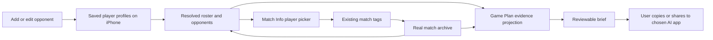

# Feature proposal: Opponents before the first match

**Status:** Proposed future feature — design only; no implementation.

**Date:** 14 November 2026

**Surface:** iPhone Opponents, player management, Match Info and Prepare Game Plan.

## 1. Purpose and scope

Let a player save an opponent, write scouting notes and prepare a game plan
before recording their first match against that person. After the first match,
the same identity connects those observations to recorded results.

Recommended first release: **add opponent → save playing profile and scouting
notes → prepare first-match brief → attach the first recorded match**.
This proposal extends [Opponent Game Plan](OPPONENT_GAME_PLAN_PROPOSAL.md) and
revisits the archive-derived roster decision in
[Match Details §5](MATCH_TAGS_PLAN.md).
Those documents describe current behaviour; this document describes a future
change, not an already available capability.

The first release does not add scheduling, an upcoming `MatchRecord`, Watch
opponent selection, contact imports, opponent lookup, an embedded AI service,
or storage of AI-generated responses. The chosen AI app continues to write and
display the plan. No new dependencies or account are needed.

## 2. Current constraint and reusable foundations

`PlayerRoster.entries` reconstructs players from `MatchRecord.tags`;
`OpponentDirectory.entries` requires an appearance in opposition tags. There
is no independent player store. A person without a tagged match cannot survive
a relaunch or appear as an opponent. `RosterEntry.lastPlayed` is non-optional.

The existing playing profile already supplies handedness, backhand, play style
and `playingNotes` (up to 280 characters). Player IDs already survive renames
and distinguish different people with the same name. Match Info provides a
player picker, and player management supports editing, merging and forgetting.

Prepare Game Plan already projects playing profiles and opted-in scouting
notes separately from selected match evidence. It also accepts upcoming context
and preparation text. Its current empty-history copy directs the user back to
tagging a past match. Reuse the projection, preview, token estimate and explicit
copy/share/AI-app launch flow, with a purposeful no-history presentation.

## 3. User experience

### Add an opponent

- Rename the Matches screen's **Head-to-head records** entry to **Opponents**.
  Keep it accessible when the archive is empty.
- Add **+ Add Opponent** in the directory toolbar and an **Add Opponent** action
  in its empty state. Suggested empty copy: “Save an opponent to collect notes
  and prepare before your first match.”
- Present a sheet requiring only a name. Offer optional handedness, backhand,
  playing style and **Scouting notes**, using the existing Playing Style notes
  field and its 280-character limit. Unknown attributes remain unset.
- Suggest existing matching names before creating a new identity; allow two
  different people to share a name. Never merge automatically by name.
- Save durably before dismissing, then open the saved opponent's page. Cancel
  creates nothing; a failed save keeps the form and its draft visible.

### Opponent page before any match

Show the profile and editable scouting notes, then a prominent **Prepare Game
Plan** action. Use **Not played yet** in directory rows. Replace empty numerical
head-to-head tables with “You haven't played this opponent yet.” Do not invent
a last-played date or imply that a zero-match record measures performance.

The player can return to edit notes or prepare again without creating a match.
Saved opponents remain searchable alongside previously played opponents; use
name and UUID to break ties deterministically when no activity date exists.
Keep recently played opponents first and list never-played opponents by name.

### Prepare for the first match

Use the existing Prepare Game Plan screen with these adjustments:

- Show **Match evidence: None yet** and explain that preparation will use the
  profile, included scouting notes and upcoming context. Match filters and
  point-detail/part-size controls are unnecessary when no eligible matches exist.
- Keep optional competition, format, date and preparation focus. With no prior
  meeting, leave competition and format unset, as the existing bare upcoming
  context does. Both remain visibly editable by the user.
- Keep Includes, complete Preview, token estimate and hand-off actions. Preserve
  existing names/playing-style-notes inclusion defaults and make the included
  content explicit. Do not show a match-notes chooser when there are no notes
  attached to selected matches.
- Allow a name-only opponent. Explain that the resulting brief requests a
  general opening plan and questions to investigate; do not require speculative
  scouting to unlock preparation.

Scouting notes persist with the player. Upcoming context and preparation focus
remain session-local, as today; label this clearly. Persisting preparation
drafts or returned plans is a separate feature.

### Attach the first match

Make saved opponents available in the existing Match Info player picker and
Settings → Players. Selecting one reuses its UUID and profile snapshot. The
user can tag the match on the phone during or after play through existing
supported flows; there is no automatic association with the next Watch match.

Once a completed singles match is tagged, head-to-head and the existing game
plan evidence selection become available. An unfinished checkpoint remains
unfinished and follows the existing finishing-match rules. A partner appearance
never counts as opposition, and doubles evidence remains excluded from the
singles game plan.

## 4. Coaching without recorded evidence

The brief must distinguish measured match evidence from user-entered
observations. With zero eligible recorded matches, state:

> No recorded singles matches against this opponent are included. The playing
> profile and scouting notes are user observations, not measured match evidence.

Ask the chosen coach for:

1. A provisional opening strategy for serve, return and rallies.
2. Warm-up and early-game checks to test the reported tendencies.
3. Three practical priorities and a Plan B if the observations prove wrong.
4. The main unknowns and what to observe for the next meeting.

Example input: “Left-handed; strong first serve; seems uncomfortable with low
balls. My focus is to stop rushing returns.” The request should frame those
traits as hypotheses to test, not established statistical weaknesses.

With no profile or notes, request a general plan and say no opponent-specific
tactical conclusion is supported. Do not fabricate head-to-head figures,
strengths, weaknesses, serve placement or fitness. Keep free text quoted as
data, never instructions. Omit empty statistical tables and match dossiers.

Distinguish **no matches recorded**, **only ineligible evidence** (such as
doubles), and **no matches selected after filters**. All may produce a brief
without match evidence, but its explanation must state the actual reason.
Never silently replace an intentional empty selection with archived matches.

## 5. Proposed data ownership

Introduce a versioned, phone-owned saved-player store alongside the archive.
Use one identity for a person whether they are an opponent or partner. Suggested
model names below describe responsibilities, not committed API signatures.

| Data | Owner and policy |
|---|---|
| Saved player | UUID, current name/profile/scouting notes, creation time and an independent revision clock (`updatedAt` + `revisionID`). |
| Directory membership | A saved “show in Opponents” marker, set by Add Opponent or an opposition appearance. A partner-only player stays out unless explicitly added as an opponent. |
| Match tags | Existing per-match player snapshots and independent tag revisions; continue to travel with matches. |
| Match count / last played | Derived from real archive records; last played is optional. Opponent rows count opposition appearances, not partner appearances. |
| Head-to-head / eligible evidence | Existing completed-result, singles/doubles, opposition and checkpoint rules. |
| Forgotten identities | Existing forgotten-player ledger, extended to scrub saved profiles too. |

The visible roster combines saved profiles and archive-derived identities by
UUID. A saved profile is authoritative for the current displayed name and
playing profile; archive tags provide a fallback for identities with no saved
profile. A later-arriving match must not overwrite an existing saved profile,
even if unrelated tag edits gave that match a newer tag timestamp.

On first initialization, resolve existing players using today's roster rules
and seed saved profiles with their existing UUIDs and winning profile values.
This migration is idempotent, excludes forgotten IDs and must succeed durably
before being marked complete. No historical records need new fields. After
initialization, previously unseen identities arriving through a match are
seeded from its tags; never reseed an existing or forgotten identity. Migration
and later opposition appearances also persist directory membership, so deleting
the last match does not hide a saved opponent. This membership update does not
overwrite the current saved name or profile.

Profile edits update the saved profile and continue today's rewrite of matching
local tag snapshots, with fresh tag revisions and pushes only for affected
matches the Watch holds. New Match Info selections snapshot the saved profile.
Explicit clears belong to a newer profile revision; an absent field in an old
file means no information and cannot undo a clear.

All profile/archive mutations must run through one serialized coordinator.
Implementation must provide recoverable multi-file commits (for example a
journal) before claiming all-or-nothing success across profiles, tags and the
ledger. Publish UI state and send Watch updates only after the durable commit.
Unreadable or newer-version files suspend affected writes and surface an error;
they never become empty stores.

The diagram describes the proposed feature. Current production architecture
diagrams must continue to describe shipped behaviour until implementation.

## 6. Lifecycle, backup and privacy

### Retention, merge and forget

- Deleting a match does not delete its saved players or scouting notes, including
  when it was their last match. Forget player is the explicit removal action.
- Rename updates one stable identity. Merging duplicates keeps the chosen ID,
  combines directory membership, and requires a visible choice when both profiles
  contain different scouting notes; do not silently discard or concatenate past
  the 280-character limit. Retire the duplicate ID using deletion intent so old
  backups cannot recreate a second visible player; stale duplicate tags are
  scrubbed, consistent with current forgetting rules.
- Forget removes the saved profile, scrubs match tags and records deletion intent
  before publishing success. Existing optional deletion of private match notes
  remains separate; those notes belong to matches. Apply the ledger to every
  inbound profile, archive, restore and import, regardless of revision dates.

### Backup and compatibility

Saved profiles must participate in the existing iCloud backup/initial-restore
policy and manual Backup & Transfer. Preparation still works offline; this adds
no continuous multi-device cloud sync or standalone Watch roster payload.

| Path | Required future behaviour |
|---|---|
| iCloud backup | Include versioned profiles and deletion intent, even with zero matches. Preserve one-way backup after initial setup. |
| Initial restore | Recognize a profiles-only backup as non-empty; preview player count as well as match count. A pending restore or download blocks overwriting the backup. |
| Manual export | Add an optional saved-player section and show profile count/content disclosure. Zero-match exports must be valid. |
| Merge import | Union IDs, resolve profile revisions deterministically, then apply the unioned forgotten ledger. Profiles merge by their own clock, not match clocks. |
| Replace import | When a profiles section is present, replace the saved-profile collection, then seed identities needed by imported matches. Keep the unioned deletion ledger. Omitted profiles in an old file mean no information and preserve local profiles; preview this explicitly. |
| Missing/corrupt data | Missing legacy sections remain compatible. Corrupt, unsupported or unreadable profile data is an error, never permission to overwrite with emptiness. |

Older app versions can ignore an additive manual-archive section and drop it on
re-export; disclose that limitation. Do not promise that an old backup restored
without a later deletion ledger can enforce later forget actions. Choose exact
file layout/schema changes during implementation, with fixture tests for old
archives and profiles-only backups before release.

### Notes and export boundaries

Reuse `playingNotes` semantics: scouting notes are profile metadata. When a
player is attached to a match they can travel in its tags through Watch sync,
iCloud backup and manual archives, as today. They are distinct from the
backup-excluded private `MatchNotesStore`; do not describe scouting notes as
device-only private notes.

Game Plan includes them only through its existing inclusion choice. Turning off
names does not redact names typed inside notes; retain the existing disclosure.
The pack builder receives only the allowlisted evidence projection, with names
and notes already removed when excluded, and no Health-derived fields. Never
read the new profile store directly from an export builder. Ordinary reports and
AI Coach must not acquire scouting notes merely because the directory can now
persist them. Review store/privacy copy when implementation ships.

## 7. Implementation impact and feasibility

**Assessment: medium-sized feature with substantial UI and coaching reuse.**
The main work is durable profile ownership, migration and recovery across stores,
backup/restore and import, rather than the Add Opponent form. There is no need
to change scoring rules, create placeholder matches or add a new `MatchRecord`
field. No elapsed-time estimate is committed by this proposal.

| Area | Expected work |
|---|---|
| Core | Versioned saved-profile model/codec, revision merge, directory resolution, optional activity date, migration and backup policies. Preserve current opponent eligibility and result calculations. |
| iPhone persistence | Serialized profile/archive mutations, recovery, initialization, import/export and backup integration; extend rename/merge/forget. |
| iPhone UI | Add form, empty states, player picker/management integration, optional-date rows and the no-evidence Game Plan presentation. |
| Game Plan | Resolve the saved opponent, add profile changes to build identity, update zero-evidence pack wording, preview and estimates. Preserve finishing-match and historical-evidence paths. |
| Watch | Reuse existing match-tag updates. No new opponent picker, roster sync or scoring behaviour in this scope. |
| Browser demo | Mirror opponent creation, persistence, management and picker behaviour. Game Plan parity is already open; track it explicitly rather than claiming native/browser parity. |

Suggested delivery sequence: (1) Core policies and migration fixtures;
(2) durable iPhone persistence and all backup/import paths; (3) directory and
management UI; (4) no-history brief and first-match workflow; (5) integration
verification and demo coverage. Do not release a creation UI whose saved
opponents cannot survive relaunch, transfer or recovery.

At implementation time, update the production source inventory, applicable
architecture diagrams, `CLAUDE.md` roster guidance and both earlier feature
plans in the same code PRs. This documentation PR does not change their claims
about the currently shipped architecture.

## 8. Acceptance and validation for implementation

1. With no matches and no paired Watch, add an opponent with profile and notes,
   relaunch and prepare a reviewable brief. Match history and statistics remain
   empty; no fake or upcoming record is created.
2. A name-only opponent produces an explicitly general plan request. Notes-only
   preparation labels observations and asks for checks and adjustments, without
   invented rates or head-to-head results.
3. Tag the first real match using the existing saved player. UUID and notes stay
   the same; completing a singles match enables results and evidence. Doubles,
   partner-only appearances, unfinished matches and filter-empty selections keep
   their correct explanations and eligibility.
4. Existing opponents migrate once without changed UUIDs, lost profile values
   or duplicate rows. Two people with the same name remain distinct. Clearing
   notes survives relaunch and stale incoming tags.
5. Editing, merging and forgetting work before and after the first match.
   Deleting the last match retains the saved profile. Stale Watch records or
   backups do not resurrect a forgotten ID when the ledger is available.
6. Profiles-only iCloud and manual backups restore correctly. Cover merge and
   replace, omitted legacy sections, equal-clock ties, explicit clears, pending
   cloud downloads and a backup containing only deletion intent.
7. Inject failed writes and crashes between each multi-file persistence step.
   No premature success, Watch push or irreversible draft dismissal occurs;
   recovery yields a coherent state. Corrupt/newer profile files preserve bytes
   and block destructive writes.
8. With names/scouting notes excluded, their text is absent from every pack and
   staged file. Profile edits rebuild preview/files; ordinary reports and AI
   Coach retain their current disclosure boundaries.
9. Verify empty and populated screens with Dynamic Type, VoiceOver, light/dark
   appearance and keyboard interaction. Extend meaningful Core and iPhone store
   tests, then run relevant local tests/builds under `CLAUDE.md`; do not trigger
   GitHub Actions as a verification loop.

Longer scouting notes, saved preparation drafts, returned-plan storage,
appointments and Watch-side player selection remain follow-up design decisions.
